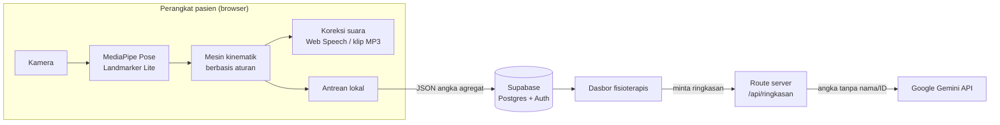

# ReminiCare

**Latihan lengan pasca-stroke di rumah, dikoreksi lewat suara.**

ReminiCare adalah Progressive Web App (PWA) untuk latihan lengan pasien pasca-stroke di rumah. Kamera ponsel atau laptop mendeteksi kompensasi batang tubuh dan bahu secara real-time di browser, lalu aplikasi memberi koreksi suara singkat dalam Bahasa Indonesia. Hasil latihan dikirim ke dasbor fisioterapis dalam bentuk angka saja. Video tidak pernah keluar dari perangkat.

| | |
|---|---|
| **Aplikasi live** | https://remini-care.vercel.app |
| **Coba tanpa akun** | https://remini-care.vercel.app/tamu |
| **Kebijakan privasi** | https://remini-care.vercel.app/privasi |
| **Repositori** | https://github.com/MantaYuana/ReminiCare |
| **Versi yang dinilai** | Release tag `submission-24h` |
| **Subtema** | Health, Well-being, and Accessibility |

---

## Daftar isi

1. [Masalah dan solusi](#masalah-dan-solusi)
2. [Fitur utama](#fitur-utama)
3. [Cara mencoba](#cara-mencoba)
4. [Cara kerja sistem](#cara-kerja-sistem)
5. [Arsitektur dan teknologi](#arsitektur-dan-teknologi)
6. [Model data dan keamanan](#model-data-dan-keamanan)
7. [Privasi dan bukti nol bingkai video](#privasi-dan-bukti-nol-bingkai-video)
8. [Pengujian dan status validasi](#pengujian-dan-status-validasi)
9. [Batas klaim dan regulasi](#batas-klaim-dan-regulasi)
10. [Keterbatasan](#keterbatasan)
11. [Menjalankan secara lokal](#menjalankan-secara-lokal)
12. [Struktur repositori](#struktur-repositori)
13. [Tim](#tim)
14. [Aset yang dibuat sebelum Hacking Day](#aset-yang-dibuat-sebelum-hacking-day)
15. [AI Use and Third-Party Declaration](#ai-use-and-third-party-declaration)
16. [Lisensi](#lisensi)

---

## Masalah dan solusi

### Masalah

Pasien pasca-stroke dengan kelemahan lengan perlu berlatih berulang kali di rumah, di antara jadwal kontrol ke fisioterapis. Saat lengan yang lemah sulit menjangkau, tubuh secara alami **mengompensasi**: batang tubuh condong ke depan, miring ke samping, atau bahu terangkat. Gerakan kompensasi ini terasa berhasil, padahal lengan yang seharusnya dilatih justru tidak bekerja. Di rumah tidak ada yang mengingatkan, dan fisioterapis tidak punya data objektif tentang apa yang terjadi di hari-hari tanpa tatap muka.

### Solusi

ReminiCare menempatkan "pengingat" itu di perangkat yang sudah dimiliki keluarga:

1. **Fisioterapis** menyusun resep latihan dan menghubungkannya ke akun pasien lewat QR.
2. **Pasien** berlatih di depan kamera. Aplikasi menghitung repetisi dan mengucapkan koreksi singkat ("Punggung tetap menempel sandaran", "Badan jangan miring", "Turunkan bahu, rileks") saat kompensasi terdeteksi.
3. **Hasilnya** berupa persentase repetisi terkompensasi, metrik gerak, dan laporan nyeri. Semuanya muncul di dasbor fisioterapis, yang mengurutkan pasien menurut prioritas dan menandai tren perburukan.

Keputusan klinis tetap di tangan fisioterapis. Sistem tidak pernah mengubah resep sendiri.

---

## Fitur utama

### Untuk pasien dan keluarga

- **Masuk sekali dengan Google**, lalu langsung ke beranda setiap kali aplikasi dibuka. Tidak ada kata sandi yang perlu diingat.
- **Hubungkan ke fisioterapis** dengan memindai QR atau mengetik kode 8 karakter.
- **Layar persetujuan** yang juga dibacakan suara: tujuan, data yang disimpan, masa simpan, hak pasien, dan lokasi server. Persetujuan bisa diberikan pasien sendiri atau wali atas nama pasien.
- **Mulai latihan dalam 2 ketukan** dari beranda.
- **Panduan posisi kamera** dengan pemeriksaan otomatis: latihan baru bisa dimulai bila tubuh terlihat jelas.
- **Kalibrasi 5 detik setiap sesi**, karena posisi kamera di rumah selalu berubah.
- **Koreksi suara real-time** (maksimal satu kalimat per repetisi), hitungan repetisi, video peragaan gerakan, dan indikator bingkai berwarna dengan label teks.
- **Ringkasan sesi**: total repetisi, repetisi benar, grafik 7 sesi terakhir, dan lapor nyeri dengan satu ketukan.
- **Tetap jalan saat internet putus**: hasil sesi disimpan di antrean lokal dan dikirim otomatis saat koneksi kembali.
- **Hapus data saya**: satu tombol untuk mencabut persetujuan dan menghapus seluruh riwayat latihan.

### Untuk fisioterapis

- **Daftar pasien terurut prioritas**: eskalasi terbuka, nyeri di sesi terakhir, kepatuhan 7 hari di bawah 50%, lalu persentase terkompensasi tertinggi. Tiap baris punya lencana alasan.
- **Penyusun resep**: sisi terdampak, gerakan (jangkau depan, jangkau samping), repetisi (5–20), sesi per minggu (1–7), toleransi per penanda (Abaikan / Longgar / Normal / Ketat), ambang durasi kompensasi, mode koreksi suara (Penuh / Mati), dan pilihan kalimat koreksi condong.
- **Detail pasien**: grafik tren persentase terkompensasi, kepatuhan, riwayat nyeri, persentase tak terukur, dan metrik kinematik per gerakan.
- **Penanda eskalasi otomatis** berbasis aturan statistik run chart, lengkap dengan grafik dasarnya, dan form **Tinjau** (Lanjutkan / Ubah resep / Jadwalkan tatap muka).
- **Ringkasan AI** 3–5 kalimat dari data 14 hari terakhir, dengan pemeriksaan angka otomatis dan tombol untuk melihat angka persis yang dikirim ke model.
- **Data contoh** untuk mencoba dasbor tanpa pasien sungguhan, yang bisa diatur ulang kapan saja.

### Tanpa akun

- **Mode tamu**: siapa saja bisa mengisi resep, kalibrasi, dan berlatih dengan koreksi suara tanpa mendaftar. Tidak ada data yang disimpan.

---

## Cara mencoba

> **Penting:** alur pasien membutuhkan **akun Google kedua** di ponsel, karena satu akun Google hanya bisa memegang satu peran (fisioterapis *atau* pasien). Untuk sekadar merasakan deteksi dan koreksi suara, gunakan mode tamu.

**Persiapan:** Chrome di laptop atau ponsel Android, kamera, dan suara perangkat menyala. Duduk di kursi bersandaran tanpa sandaran tangan, kamera setinggi dada, jarak sekitar 1,5–2 m, tampak depan, kepala sampai pangkuan terlihat.

### A. Mode tamu (tanpa akun, ±3 menit)

1. Buka https://remini-care.vercel.app, lalu klik **Coba latihan sekarang** (atau langsung ke `/tamu`).
2. Isi resep. Nilai bawaannya sudah siap pakai: jangkau depan, 5 repetisi, mode koreksi Penuh.
3. Klik **Mulai latihan**, izinkan kamera, lalu ikuti panduan posisi kamera.
4. Diam selama kalibrasi 5 detik, lalu lakukan gerakan jangkau. Coba condongkan badan ke depan atau miring ke samping saat menjangkau untuk mendengar koreksi suara.
5. Lihat ringkasan di akhir sesi. Data tidak disimpan.

### B. Alur lengkap fisioterapis + pasien (±10 menit)

**Di laptop, sebagai fisioterapis:**

1. Buka https://remini-care.vercel.app, klik **Buat akun**, pilih peran **Fisioterapis**, lalu **Sign Up as Fisioterapis** dengan akun Google Anda.
2. Di menu samping, klik **Isi data contoh**. Dasbor terisi 5 pasien sintetis dengan riwayat 5 minggu.
3. Buka **Pak Wayan** (berstatus eskalasi):
   - lihat run chart yang memicu eskalasi dan tren persentase repetisi terkompensasi;
   - klik **Lihat Ringkasan** di bagian Ringkasan AI.
4. Kembali ke beranda dan klik **Tambahkan Pasien**. Contoh isian:
   - Nama panggilan: `Uji Demo`
   - Sisi terdampak: Kanan
   - Gerakan: Jangkau depan
   - Repetisi: 5
   - Mode koreksi suara: Penuh
   - Kalimat koreksi tubuh condong: Menempel sandaran
5. Simpan, lalu di detail pasien klik **Buat Tautan**. QR dan tautan pasien akan muncul.

**Di ponsel, sebagai pasien:**

6. Pindai QR (atau buka tautannya), lalu **Sign Up as Pasien** dengan **akun Google kedua**.
7. Baca layar persetujuan, lalu tekan **Setuju**.
8. Di beranda pasien, tekan kartu latihan untuk mulai.
9. Ikuti panduan kamera, kalibrasi 5 detik, lalu latihan dengan koreksi suara.
10. Di akhir sesi, laporkan nyeri (opsional), lalu tekan **Selesai**.

**Kembali ke laptop:**

11. Klik **Muat ulang** di dasbor, lalu buka pasien **Uji Demo**. Sesi dari ponsel muncul di detail pasien.
12. Klik **Atur ulang contoh**, lalu **Ya, atur ulang**. Data contoh kembali ke kondisi awal, sehingga demo bisa diulang.

Setiap penguji memakai akun Google sendiri, jadi data contoh antar-penguji tidak saling bertabrakan.

### Pasien sintetis di data contoh

| Pasien | Pola yang ditunjukkan |
|---|---|
| Pak Wayan | Memburuk, sehingga eskalasi terbuka |
| Bu Made | Stabil, dengan laporan nyeri di sesi terakhir |
| Pak Nyoman | Jarang berlatih (kepatuhan rendah) |
| Bu Ketut | Membaik |
| Pak Komang | Stabil dan baik |

Semua sesi sintetis diberi lencana **Data sintetis** di dasbor.

---

## Cara kerja sistem

### Alur data



Bingkai video dan landmark mentah hanya hidup di memori perangkat dan dibuang setelah diproses. Yang dikirim ke server hanya angka agregat per sesi.

### 1. Deteksi pose di perangkat

- Kamera depan 640×480 (resolusi rendah sengaja dipilih demi fps) diproses oleh **MediaPipe Pose Landmarker Lite** (`@mediapipe/tasks-vision` 1.2.0) dalam mode video.
- GPU dipakai bila tersedia. Bila GPU gagal, landmarker dibuat ulang dengan CPU, dan delegate yang dipakai dicatat di sesi.
- Model dan WebAssembly disajikan dari origin sendiri di `/mediapipe/1.2.0/` dengan header cache `immutable`, sehingga hanya diunduh sekali.
- Landmark yang dipakai: telinga, bahu, siku, pergelangan tangan, dan panggul. Kiri/kanan mengacu ke tubuh pasien, bukan ke gambar. Tampilan kamera dicerminkan lewat CSS saja.

### 2. Praproses sinyal

1. **Resample ke 30 Hz** dengan interpolasi linear, karena fps kamera tidak rata (15–30 fps).
2. **Filter low-pass Butterworth orde 2, fc 5 Hz.** Saat live dipakai filter kausal. Analisis per repetisi setelah selesai memakai filter zero-phase (maju-mundur).

### 3. Gating keyakinan

Sebuah frame hanya dihitung bila **semua landmark kunci berada di dalam gambar** dan **skor visibility minimum** (median dalam jendela 1 detik) cukup tinggi. Syarat "di dalam gambar" wajib, karena MediaPipe tetap memberi visibility tinggi untuk titik yang diekstrapolasi di luar bingkai.

- Gating aktif bila syarat gagal atau skor < 0,5 selama lebih dari 1 detik, dan lepas bila skor ≥ 0,6 selama 1 detik (histeresis).
- Saat gating aktif, koreksi dimatikan dan suara meminta pasien memperbaiki posisi.
- Repetisi yang lebih dari 50% fase geraknya tergating ditandai **tak terukur** dan tidak masuk penyebut persentase.

### 4. Kalibrasi baseline (5 detik, setiap sesi)

Pasien duduk diam dengan tangan di paha. Baseline adalah **median** sampel yang lolos syarat diam, bukan rata-rata. Yang dihitung: lebar bahu (satuan normalisasi seluruh sesi), tinggi batang, sudut batang terhadap vertikal, jarak telinga–bahu sisi terdampak, posisi istirahat pergelangan, dan kedalaman bahu 3D.

Kalibrasi gagal bila tubuh bergerak (simpangan baku titik tengah bahu > 0,02 lebar bahu). Setelah 3 kali gagal, muncul bantuan penempatan kamera.

### 5. Fitur dan penanda kompensasi

Semua fitur dinormalisasi terhadap baseline pasien itu sendiri, jadi yang diukur adalah *perubahan* dari postur duduknya, bukan postur absolut.

| Fitur | Arti | Dipakai untuk |
|---|---|---|
| `w` | Bahu tampak melebar (tubuh mendekati kamera) | Condong ke depan |
| `d` | Batang tubuh tampak memendek | Condong ke depan |
| `Δθ` | Perubahan sudut batang terhadap vertikal | Miring ke samping |
| `el` | Jarak telinga–bahu sisi terdampak menyusut | Bahu terangkat |

- **Penanda BATANG** aktif bila condong (`w` **dan** `d` melewati ambang) **atau** miring (`Δθ` melewati ambang). Syarat "dan" membedakan condong dari rotasi badan, karena rotasi justru mempersempit bahu di gambar.
- **Penanda BAHU** aktif bila `el` melewati ambang. Ini penanda terlemah (lihat [Keterbatasan](#keterbatasan)).

Ambang dasar per gerakan:

| Gerakan | Condong `w` | Condong `d` | Miring `Δθ` | Bahu `el` |
|---|---|---|---|---|
| Jangkau depan | 0,06 | 0,04 | 6° | 0,15 |
| Jangkau samping | 0,06 | 0,04 | 8° | 0,25 |

Ambang bahu jangkau samping sengaja lebih tinggi, karena mengangkat lengan ke samping secara wajar ikut menaikkan titik bahu. Toleransi resep dikalikan ke ambang: **Ketat** ×0,75, **Normal** ×1, **Longgar** ×1,5, sedangkan **Abaikan** mematikan penanda itu.

### 6. Hitung repetisi

Jarak pergelangan tangan dari posisi istirahatnya (dinormalisasi lebar bahu) menggerakkan mesin status **DIAM → BERGERAK (> 0,25) → JAUH (> 0,6) → kembali < 0,25 = satu repetisi**. Repetisi sah bila durasinya 0,8–15 detik dan sempat mencapai JAUH.

Setelah repetisi selesai, kecepatan pergelangan dihitung ulang dengan filter zero-phase. **Fase gerak** adalah rentang saat kecepatan di atas 10% kecepatan puncak.

### 7. Keputusan per repetisi

Untuk tiap penanda, dihitung fraksi sampel fase gerak dengan penanda aktif. Penanda dianggap terkompensasi bila fraksinya ≥ ambang durasi di resep (bawaan 30%). **Repetisi terkompensasi bila minimal satu penanda terkompensasi.** Metrik utama sesi adalah:

> % repetisi terkompensasi = repetisi terkompensasi ÷ repetisi terukur × 100

### 8. Koreksi suara

- Pada mode **Penuh**, penanda yang aktif terus-menerus **≥ 300 ms** selama fase gerak (dan gating tidak aktif) memicu satu kalimat koreksi.
- **Maksimal satu kalimat per repetisi.** Penanda batang didahulukan atas bahu. Ada jeda pengaman 4 detik untuk kalimat yang sama dan 1,5 detik antar-kalimat.
- Kalimat condong bisa dipilih fisioterapis: "Punggung tetap menempel sandaran" atau "Punggung tetap tegak".
- Setelah tiap gerakan, ringkasan suara 3 tingkat diputar berdasarkan persentase repetisi benar: ≥ 80% baik, 50–79% cukup, < 50% perlu diperbaiki.
- Mode **Mati** tidak memutar koreksi, ringkasan, maupun kanal visual, tapi hitungan tetap berjalan. Sesi seperti ini menjadi data kompensasi tanpa umpan balik bagi fisioterapis, sekaligus pilihan bagi pasien yang tidak cocok dengan umpan balik suara.

**Jalur suara:**

1. **Web Speech API** dengan suara Bahasa Indonesia **lokal** (`localService === true`). Suara jaringan sengaja tidak dipakai, karena akan mengirim teks ke server pihak ketiga dan gagal saat luring.
2. **Cadangan: 46 klip MP3** rekaman suara anggota tim. Klip dipakai bila tidak ada suara id-ID lokal, bila ucapan pemanasan gagal, atau bila latensinya lebih dari 500 ms. Di iOS selalu dipakai klip.

Ketukan pertama "mulai" sekaligus membuka AudioContext dan memutar ucapan pemanasan, agar kedua jalur lolos kebijakan autoplay browser.

### 9. Metrik sesi

Per repetisi terukur dihitung **waktu gerak** (metrik utama), **kecepatan puncak**, dan **jumlah puncak kecepatan**. Per gerakan per sesi disimpan median-nya. Dua metrik terakhir diberi label "kurang andal" di dasbor. Semua metrik bersifat 2D dan hanya untuk melihat tren pasien itu sendiri, tidak untuk dibandingkan antar-pasien atau dengan nilai literatur.

### 10. Antrean kirim offline

Sesi ditulis ke antrean `localStorage` saat selesai, lalu dikirim. Bila gagal, pengiriman dicoba lagi saat event `online`, saat aplikasi kembali terlihat (`visibilitychange`), dan setiap kali aplikasi dibuka. ID sesi dibuat di klien (UUID) dan dikirim dengan upsert, jadi pengiriman ulang tidak menggandakan data. Beranda menampilkan "N sesi menunggu dikirim" selama antrean belum kosong.

### 11. Eskalasi otomatis

Trigger database mengevaluasi setiap sesi baru dengan **aturan shift run chart Anhøj (2014)**:

- **Titik data:** persentase terkompensasi per sesi dengan minimal 5 repetisi terukur, sejak tinjauan terakhir.
- **Median baseline:** median 6 titik pertama, lalu dibekukan.
- **Sinyal:** eskalasi terbuka bila jumlah titik berturut-turut **di atas median** (arah perburukan) melebihi `round(log2(n) + 3)`, dengan n = jumlah titik yang tidak tepat di median.

Penanda menampilkan dasarnya sebagai run chart, supaya fisioterapis bisa menilai sendiri. Setelah fisioterapis memilih **Tinjau** dan mencatat keputusan, penanda tertutup dan perhitungan dimulai ulang dari sesi berikutnya. Galat di trigger ditangkap di dalam fungsi, sehingga tidak pernah membatalkan penyimpanan sesi.

### 12. Ringkasan AI untuk fisioterapis

Tombol Ringkasan AI di detail pasien memanggil route server `/api/ringkasan`:

1. Route memverifikasi token Supabase fisioterapis dan membaca data **dengan token itu**, sehingga Row Level Security tetap berlaku. Service role key tidak dipakai.
2. Route menyusun agregat **angka saja** dari 14 hari terakhir: persentase terkompensasi per sesi, kepatuhan, nyeri, persentase tak terukur, mode koreksi, metrik kinematik, dan status eskalasi. **Tanpa nama, ID pasien, tanggal absolut, video, atau landmark.**
3. Agregat dikirim sebagai JSON terstruktur ke Gemini (temperature 0,2, maksimal 400 token, timeout 8 detik). Prompt melarang diagnosis dan saran perubahan resep.
4. **Mitigasi halusinasi:** setiap angka di keluaran harus ada di masukan, dan keluaran harus terdiri dari 3–5 kalimat. Bila pemeriksaan gagal, API error, atau kuota habis, yang tampil adalah **ringkasan templat deterministik** yang dihitung kode.
5. Keluaran diberi label **"Ringkasan AI, cek grafik sebelum memutuskan"**, dan fisioterapis bisa membuka **Lihat angka yang dikirim** untuk melihat payload persisnya.

---

## Arsitektur dan teknologi

| Lapisan | Teknologi | Alasan |
|---|---|---|
| Frontend | Next.js 16 (App Router), React 19, TypeScript, Tailwind CSS 4 | Satu basis kode untuk dasbor dan PWA pasien, plus route server untuk Ringkasan AI |
| Deteksi pose | MediaPipe Pose Landmarker Lite 1.2.0 (WebAssembly, GPU dengan cadangan CPU) | Berjalan sepenuhnya di browser, jadi video tidak perlu dikirim |
| Mesin kinematik | TypeScript murni (`lib/kinematik/`) | Berbasis aturan geometris: bisa dijelaskan, disetel per pasien, dan diuji unit |
| Suara | Web Speech API (suara lokal) + 46 klip MP3 | Latensi rendah dan tetap bekerja tanpa internet |
| Backend | Supabase: Postgres, Auth (Google OAuth2), RPC, trigger | RLS di semua tabel, logika sensitif di fungsi database |
| AI | Google Gemini API (`gemini-3.5-flash-lite`) lewat route server | Ringkasan bahasa alami untuk fisioterapis, dengan pagar pengaman |
| Hosting | Vercel (HTTPS) | Deploy dari GitHub, kunci API hanya di environment server |
| PWA | Web App Manifest + ikon | Bisa dipasang ke layar utama ponsel |

Region Supabase: **ap-southeast-1 (Singapura)**.

---

## Model data dan keamanan

### Tabel

| Tabel | Isi |
|---|---|
| `profil` | Nama tampilan dan peran akun (fisioterapis / pasien) |
| `pasien` | Nama panggilan, resep latihan, kode klaim, catatan persetujuan, penanda data sintetis |
| `sesi` | Salinan resep yang dipakai, ringkasan baseline (angka), jumlah repetisi total/terukur/terkompensasi, metrik per gerakan, fps median, jalur suara, delegate, nyeri |
| `eskalasi` | Sesi pemicu, median baseline, panjang run dan batasnya, keputusan dan catatan tinjauan |

### Fungsi database (RPC)

| Fungsi | Kegunaan |
|---|---|
| `daftar` | Mencatat peran saat sign up. Satu akun = satu peran, dan peran tidak bisa diganti |
| `buat_kode` | Membuat kode klaim acak 8 karakter (berlaku 7 hari, sekali pakai). Kode baru membatalkan kode lama dan melepas akun lama |
| `klaim_pasien` | Mengikat akun pasien ke data pasien, sekaligus mencatat persetujuan. Akun fisioterapis ditolak |
| `lapor_nyeri` | Menyimpan laporan nyeri untuk sesi milik pasien itu sendiri |
| `cabut_persetujuan` | Menghapus sesi dan eskalasi pasien, lalu melepas akun dari data pasien |
| `isi_contoh` | Mengisi atau mengatur ulang 5 pasien sintetis milik akun fisioterapis pemanggil |
| `terapis_saya` | Memberi pasien nama dan foto profil fisioterapisnya saja (tanpa email) |
| `cek_eskalasi` | Trigger aturan run chart pada setiap sesi baru |

### Lapisan keamanan

- **Row Level Security aktif di semua tabel.** Fisioterapis hanya melihat pasiennya sendiri, dan pasien hanya bisa menulis sesi untuk dirinya sendiri.
- Fungsi sensitif berjalan sebagai `security definer` dengan `search_path` kosong, dan hak eksekusinya dicabut dari peran anonim.
- Klien hanya memegang **publishable key** Supabase. Kunci Gemini hanya ada di environment server Vercel.
- Login hanya lewat Google OAuth. Tidak ada kata sandi yang disimpan, dan anonymous sign-in dimatikan.
- Uji SQL untuk RLS antar-akun dan aturan eskalasi ada di [`supabase/tests/`](supabase/tests/).

---

## Privasi dan bukti nol bingkai video

**Video kamera tidak pernah dikirim atau disimpan.** Bingkai diproses di memori perangkat, landmark mentah dibuang setelah tiap repetisi, dan yang dikirim ke server hanya angka agregat sesi.

### Data yang disimpan

| Data | Lokasi | Siapa yang melihat |
|---|---|---|
| Email dan nama akun Google | Supabase Auth, hanya untuk masuk | Tidak ditampilkan ke fisioterapis |
| Nama panggilan dan resep latihan | Tabel `pasien` | Fisioterapis yang merawat |
| Hasil sesi: jumlah repetisi, persentase terkompensasi, metrik gerak, nyeri | Tabel `sesi` | Fisioterapis yang merawat dan pasien sendiri |
| Baseline kalibrasi (angka geometris ternormalisasi, bukan gambar) | Tabel `sesi` | Fisioterapis yang merawat |
| Catatan persetujuan (versi, waktu, oleh pasien/wali) | Tabel `pasien` | Fisioterapis yang merawat |

- **Masa simpan:** sampai pasien menghapusnya, atau sampai proyek demo ditutup, paling lama 90 hari.
- **Hak pasien:** tombol **Hapus data saya** di beranda pasien menghapus seluruh sesi dan eskalasi saat itu juga, lalu melepas akun dari data pasien.
- **Pihak ketiga:** Supabase (penyimpanan, Singapura), Vercel (hosting), Google (penyedia login), dan Google Gemini (hanya agregat angka tanpa identitas, untuk Ringkasan AI).

Penjelasan lengkap ada di [Kebijakan Privasi](https://remini-care.vercel.app/privasi) dan [penilaian dampak pelindungan data (DPIA)](docs/DPIA-ReminiCare.md).

### Cara memverifikasi sendiri lewat tab Network

1. Buka https://remini-care.vercel.app/tamu (atau sesi pasien) di Chrome desktop.
2. Buka DevTools (F12), lalu tab **Network**. Centang **Preserve log**.
3. Jalankan satu sesi lengkap sampai ringkasan.
4. Perhatikan permintaan yang muncul:
   - **Aset statis** dari origin sendiri: model dan WebAssembly MediaPipe dari `/mediapipe/1.2.0/` (diunduh sekali, lalu dari cache), klip suara dari `/audio/`, video peragaan dari `/video/`.
   - **Satu atau beberapa permintaan JSON kecil** ke Supabase saat sesi tersimpan (akun pasien). Di mode tamu, tidak ada data sesi yang dikirim ke Supabase.
   - **Tidak ada** unggahan gambar, video, `multipart/form-data`, WebSocket, atau stream media keluar.
5. Klik permintaan ke Supabase lalu tab **Payload**: isinya hanya angka dan metadata resep, tanpa landmark atau data gambar.

---

## Pengujian dan status validasi

### Unit test

Logika inti diuji dengan test runner bawaan Node.js:

```bash
npm test
```

Hasil saat rilis: **92 test, 10 suite, semua lulus.** Cakupannya:

| File | Yang diuji |
|---|---|
| `lib/kinematik/kinematik.test.ts` | Filter, resample, fitur, penanda, segmentasi repetisi, keputusan kompensasi, koreksi |
| `lib/sesi-state.test.ts` | Mesin status sesi (panduan → kalibrasi → gerakan → istirahat → ringkasan) |
| `lib/antrean.test.ts` | Antrean offline, kirim ulang, idempotensi |
| `lib/ringkasan.test.ts` | Agregat Ringkasan AI, pemeriksaan angka dan kalimat, templat cadangan |
| `lib/suara.test.ts`, `lib/naskah.test.ts` | Pemilihan suara lokal, antrean suara, kelengkapan naskah klip |
| `lib/peran.test.ts`, `lib/arah.test.ts` | Peran akun dan pengalihan setelah login |
| `lib/latihan.test.ts`, `lib/kerangka.test.ts`, `lib/uji.test.ts` | Resep latihan, kerangka overlay, ekspor CSV mode uji |

Uji database (RLS antar-akun dan aturan eskalasi) ada di `supabase/tests/uji_rls.sql` dan `supabase/tests/uji_eskalasi.sql`.

### Status validasi deteksi kompensasi

**Sensitivitas dan spesifisitas deteksi kompensasi belum diukur.** Ambang di atas adalah **nilai awal** yang diturunkan dari pemodelan geometris kamera, belum disetel dari rekaman subjek. Karena itu kami tidak melaporkan angka akurasi apa pun.

Untuk validasi, aplikasi menyediakan **mode uji di `/uji`** (tidak ditautkan dari antarmuka utama). Penguji memilih subjek, gerakan, label kondisi (normal / condong / miring / elevasi bahu), dan sudut condong target. Mode ini menampilkan nilai fitur secara langsung dan mengekspor CSV per repetisi (fitur, keputusan penanda, waktu gerak, fps, latensi suara) tanpa menyimpan bingkai. Data dari mode ini bisa langsung dipakai menyetel ambang dan menghitung sensitivitas/spesifisitas.

---

## Batas klaim dan regulasi

### Bukan alat diagnosis

ReminiCare **tidak** mendiagnosis, tidak menetapkan batas aman gerak, dan tidak menggantikan fisioterapis. Sistem tidak pernah mengubah resep sendiri. Semua keputusan tindak lanjut tetap di tangan fisioterapis.

### Jalur perangkat lunak alat kesehatan

Versi ini adalah **prototipe kompetisi dengan data sintetis**, bukan produk yang diedarkan. Perangkat lunak yang memantau terapi dengan keputusan di tangan klinisi dapat tergolong perangkat lunak alat kesehatan (KMK HK.01.07/MENKES/951/2026). KMK yang sama mensyaratkan mitigasi halusinasi untuk fitur LLM, yang kami terapkan di Ringkasan AI. Deployment klinis memerlukan:

- registrasi perangkat lunak alat kesehatan;
- penyelenggaraan lewat fasilitas pelayanan kesehatan, dengan fisioterapis ber-STR/SIP;
- penyimpanan rekam medis elektronik di server atau cloud tersertifikasi dalam negeri (Permenkes 24/2022);
- DPIA lengkap sesuai UU 27/2022 tentang Pelindungan Data Pribadi, dengan persetujuan tertulis dari pasien.

**Lokasi data:** Data sintetis, server Singapura; lokasi penyimpanan untuk deployment klinis akan disesuaikan dengan regulasi sektor kesehatan.

### Batas bukti

- **Didukung literatur:** umpan balik real-time dari kamera dengan MediaPipe menurunkan kompensasi batang tubuh selama satu sesi terawasi (Kim 2026, RCT n = 55). Deteksi miring lateral dari satu kamera didukung Pavlikov 2026.
- **Bukan klaim kami:** bahwa koreksi suara terbukti efektif, bahwa efeknya bertahan setelah umpan balik dihentikan, bahwa deteksi condong ke depan sudah tervalidasi, atau bahwa aplikasi terbukti mudah dipakai lansia Indonesia.

---

## Keterbatasan

- **Ambang deteksi belum divalidasi.** Ambang masih nilai awal dan sensitivitas/spesifisitas belum diukur, baik pada subjek sehat maupun pasien pasca-stroke.
- **Condong ke depan adalah sinyal terlemah dari kamera depan.** Syarat "`w` dan `d`" bisa jarang aktif pada condong ringan.
- **Penanda BAHU adalah penanda lemah.** Dari kamera depan, elevasi bahu sulit dipisahkan dari abduksi lengan (Pavlikov 2026 menilainya masih *research-grade*).
- **Hanya kamera tampak depan.** Posisi kamera oblik 45° belum didukung.
- **Hanya 2 gerakan:** jangkau depan dan jangkau samping.
- **Deteksi berbasis aturan, bukan machine learning**, karena belum ada dataset pasien Indonesia.
- **Metrik kinematik bersifat 2D** dan hanya untuk tren pasien itu sendiri.
- **Wawancara fisioterapis dan keluarga pasien belum dilakukan.** Persona, kalimat koreksi, dan urutan prioritas dasbor masih asumsi tim.
- **Pemeriksa angka Ringkasan AI hanya mengecek angka yang ditulis sebagai digit.** Angka yang ditulis sebagai kata ("tiga") lolos tanpa dicek.
- **Alur pasien butuh akun Google terpisah** dari akun fisioterapis.
- **Tanpa service worker.** Model dan audio di-cache browser lewat header HTTP, tapi aplikasi belum bisa dibuka pertama kali tanpa internet.
- **iOS Safari bersifat best-effort.** Suara memakai klip MP3, dan performa pose belum diukur.

---

## Menjalankan secara lokal

### Prasyarat

- Node.js 24
- Proyek Supabase
- OAuth client Google (jenis Web)
- (Opsional) API key Google Gemini. Tanpa kunci ini, Ringkasan AI memakai ringkasan templat.

### Langkah

```bash
git clone https://github.com/MantaYuana/ReminiCare.git
cd ReminiCare
npm ci
```

1. **Database:** jalankan migrasi di `supabase/migrations/` berurutan dari `0001` sampai `0005` (lewat SQL Editor Supabase atau `supabase db push`).
2. **Auth:** di Supabase, aktifkan provider **Google** dengan Client ID dan Secret dari Google Cloud, lalu daftarkan `http://localhost:3000/**` di Redirect URLs. Di Google Cloud, tambahkan URL callback Supabase sebagai Authorized redirect URI.
3. **Environment:** buat file `.env.local`:

   ```env
   NEXT_PUBLIC_SUPABASE_URL=https://<proyek>.supabase.co
   NEXT_PUBLIC_SUPABASE_PUBLISHABLE_KEY=<publishable key>
   GEMINI_API_KEY=<opsional>
   GEMINI_MODEL=gemini-3.5-flash-lite
   # GEMINI_THINKING_BUDGET=0   # opsional
   ```

4. **Jalankan:**

   ```bash
   npm run dev     # http://localhost:3000
   npm test        # unit test
   npm run build   # build produksi
   ```

Kamera di browser membutuhkan HTTPS, kecuali di `localhost`. Untuk mencoba dari ponsel di jaringan lokal, gunakan tunnel HTTPS atau deploy ke Vercel.

---

## Struktur repositori

```
app/
  page.tsx                  Landing page
  masuk/, daftar/, auth/    Login, sign up dengan pilihan peran, penerima redirect OAuth
  tamu/                     Mode tamu
  k/[kode]/                 Klaim pasien lewat QR + layar persetujuan
  pasien/                   Beranda pasien dan sesi latihan
  terapis/                  Dasbor, daftar pasien, detail, resep baru, ubah resep
  privasi/                  Kebijakan privasi
  uji/                      Mode uji untuk perekaman data berlabel
  api/ringkasan/            Route server Ringkasan AI
components/                 Komponen UI (sesi, dasbor, form resep, grafik, QR)
lib/
  kinematik/                Mesin kinematik: sinyal, fitur, repetisi, mesin utama
  pose.ts                   Pembungkus MediaPipe Pose Landmarker
  suara.ts, naskah.ts       Jalur suara dan naskah kalimat
  antrean.ts                Antrean kirim offline
  ringkasan.ts              Agregat dan pemeriksaan Ringkasan AI
  supabase.ts               Klien Supabase
supabase/
  migrations/               Skema, RLS, RPC, trigger eskalasi, data sintetis
  tests/                    Uji SQL RLS dan eskalasi
public/
  mediapipe/1.2.0/          Model dan WebAssembly MediaPipe (+ LICENSE Apache 2.0)
  audio/                    46 klip suara MP3
  video/                    Video peragaan gerakan
docs/DPIA-ReminiCare.md     Penilaian dampak pelindungan data
```

---

## Tim

| Anggota | Kontribusi utama |
|---|---|
| **Manta** | Mesin kinematik, integrasi MediaPipe, mode uji, rekaman suara dan video peragaan |
| **Ari** | Antarmuka pasien dan landing page, alur sesi latihan, jalur suara, antrean offline, PWA |
| **Pindra** | Database, RLS dan fungsi Supabase, dasbor fisioterapis, Ringkasan AI, dokumentasi |

Semua anggota memahami seluruh sistem dan siap menjelaskan bagian masing-masing.

---

## Aset yang dibuat sebelum Hacking Day

Sesuai ketentuan lomba, **tidak ada kode yang ditulis sebelum Hacking Day.** Hacking Day dimulai 31 Oktober 2026 13.00 WITA, dan commit pertama repositori ini tercatat 31 Oktober 2026 17.33 WITA. Aset non-kode berikut disiapkan sebelumnya:

- **Dokumen:** rancangan produk, wireframe layar sesi dan dasbor, tabel ambang awal, serta kerangka README dan pitch deck.
- **Audio:** 46 klip suara MP3 (41 klip instruksi, koreksi, hitungan, dan ringkasan, plus 5 klip layar persetujuan), direkam anggota tim.
- **Video:** 2 video peragaan gerakan (loop 5–10 detik, di bawah 1 MB per klip), direkam anggota tim.
- **Riset:** tinjauan literatur dan verifikasi kutipan yang menjadi dasar keputusan desain di atas.

---

## AI Use and Third-Party Declaration

### Penggunaan AI di dalam produk

| AI | Penyedia | Kegunaan | Data yang diterima |
|---|---|---|---|
| Gemini API (`gemini-3.5-flash-lite`) | Google | Ringkasan 3–5 kalimat Bahasa Indonesia untuk fisioterapis di detail pasien | Hanya agregat angka 14 hari terakhir, tanpa nama, ID pasien, tanggal absolut, video, atau landmark |
| MediaPipe Pose Landmarker Lite | Google | Estimasi 33 titik pose tubuh, berjalan di perangkat pengguna | Bingkai kamera, diproses lokal dan tidak dikirim ke mana pun |

Deteksi kompensasi sendiri **bukan** model AI. Deteksi dilakukan mesin aturan geometris buatan tim di `lib/kinematik/`.

### Penggunaan AI dalam pengembangan

| Alat | Penyedia | Kegunaan |
|---|---|---|
| Claude Code | Anthropic | Asisten pemrograman: menulis dan merefaktor kode, debugging, review kode, menulis test, serta menyusun dokumentasi |

Seluruh keluaran asisten AI ditinjau, diuji, dan di-commit oleh anggota tim. Tim bertanggung jawab penuh atas seluruh kode di repositori ini.

### Pustaka pihak ketiga

| Pustaka | Versi | Lisensi | Kegunaan |
|---|---|---|---|
| `@mediapipe/tasks-vision` (beserta model `pose_landmarker_lite`) | 1.2.0 | Apache 2.0 | Deteksi pose di browser |
| Next.js | 16.4.3 | MIT | Framework web dan route server |
| React, React DOM | 19.3.1 | MIT | Antarmuka |
| `@supabase/supabase-js` | 2.118.0 | MIT | Klien database dan auth |
| Tailwind CSS (`@tailwindcss/postcss`) | 4.3.3 | MIT | Styling |
| TypeScript | 7.0.2 | Apache 2.0 | Bahasa pemrograman |
| jsQR | 1.4.0 | Apache 2.0 | Pemindai QR di beranda pasien |
| qrcode | 1.5.4 | MIT | Pembuat QR tautan pasien |
| League Spartan, Figtree (lewat `next/font/google`) | — | SIL Open Font License 1.1 | Huruf landing page |

### Layanan pihak ketiga

| Layanan | Kegunaan |
|---|---|
| Supabase | Database Postgres, autentikasi, fungsi database (region Singapura) |
| Vercel | Hosting dan deployment |
| Google OAuth | Login dengan akun Google |
| Google Gemini API | Ringkasan AI |
| Web Speech API (bawaan browser/OS) | Suara koreksi dengan suara Bahasa Indonesia lokal di perangkat |

### Rujukan ilmiah

Keputusan desain mesin kinematik dan eskalasi merujuk pada literatur, antara lain Anhøj & Olesen (2014) untuk aturan run chart, Winter (2009) untuk filter Butterworth pada data kinematik, Kim (2026) dan Pavlikov (2026) untuk umpan balik dan deteksi kompensasi berbasis kamera, serta Levin (2016) untuk ambang onset kecepatan. Rujukan tersebut dipakai sebagai dasar desain, bukan sebagai klaim validasi produk ini.

---

## Lisensi

Kode proyek ini dirilis di bawah **MIT License**. Lihat [LICENSE](LICENSE).

MediaPipe dan model Pose Landmarker digunakan di bawah Apache License 2.0. Lihat [public/mediapipe/LICENSE](public/mediapipe/LICENSE). Klip suara dan video peragaan adalah karya tim ReminiCare.
