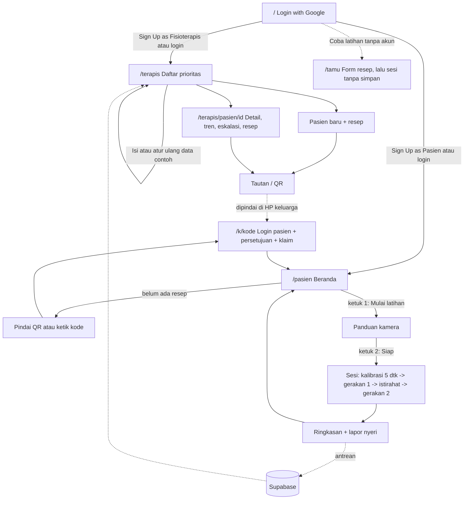
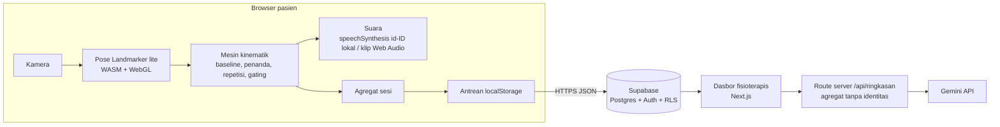

# PRD ReminiCare (Hacking Day INCEPTION 2026)

Versi 1.8, 1 November 2026. Versi 1.8 mengganti autentikasi menjadi Google OAuth2 untuk dua peran (fisioterapis dan pasien) dan mengganti sandbox juri dengan tombol data contoh (V9). Disusun dari sesi grill bersama ketua tim, direvisi setelah review riset (`reports/Review PRD ReminiCare.md`), direvisi lagi setelah riset celah bukti dan grill V2 (`reports/Celah bukti dan kamera oblik ReminiCare.md`), lalu diperbarui dengan jawaban §18 dan cek teks primer regulasi (V3 sampai V5), dan dikoreksi setelah verifikasi kutipan ke PDF (V6, `reports/Verifikasi kutipan dan celah ReminiCare.md`). Rujukan halaman bertanda V7 (Anhøj 2014, Pavlikov 2026, Kim 2026) diverifikasi mesin di `research_notes/Verifikasi kutipan dan celah ReminiCare/v7/ledger.md`. Kode bukti DR-Qxx, KT/JM/BI-Qxx, dan VT-xxx merujuk ke laporan review. Sumber dari laporan celah bukti disebut dengan nama penulis dan tahun; kutipannya belum diverifikasi ke halaman PDF. Dokumen ini adalah aset non-kode: tidak ada kode yang ditulis sebelum Hacking Day, dan repositori baru dibuat pada jam ke-0.

## 0. Status dan aturan main

| Hal | Status |
|---|---|
| Proposal | Lolos screening. |
| Tanggal Hacking Day | 31 Oktober 2026 13.00 WITA sampai 1 November 2026 11.00 WITA (22 jam, bukan 24). Jadwal jam nyata ada di spec doc (V8). |
| Challenge Brief | Tidak ada. Panitia tidak mengirim Challenge Brief (V6), jadi PRD ini dijalankan apa adanya (§13). |
| Kode | Nol baris sebelum Hacking Day (D1). Repo lomba `MantaYuana/ReminiCare` (lisensi MIT) dibuat di J0. Repo GEMASTIK sudah diganti nama menjadi `MantaYuana/ReminiCare-Gemastik` dan hanya menjadi referensi desain. Panitia memperbolehkan pemakaian riset GEMASTIK. |
| Sebelum Hacking Day | Hanya aset non-kode: PRD ini, rekaman suara, video peragaan, wireframe, tabel ambang awal, kerangka README dan pitch deck (§14). |
| Deliverables wajib | URL live yang bisa diuji, GitHub publik, README + AI Use and Third-Party Declaration, tag `submission-24h`, video maksimal 3 menit, pitch deck. Submission lewat Devpost. |

Bobot rubrik Hacking Day dipakai untuk memprioritaskan pekerjaan: Technical 25, Functionality 25, Problem-Solution Fit 15, Innovation 15, UX 10, AI/Tech 10.

## 1. Ringkasan produk

ReminiCare adalah PWA untuk latihan lengan pasca-stroke di rumah. Kamera ponsel atau laptop menjalankan MediaPipe Pose Landmarker di browser. Mesin kinematik berbasis aturan membandingkan postur pasien dengan baseline pribadinya, memutar koreksi suara Bahasa Indonesia saat batang tubuh atau bahu mengompensasi, menghitung repetisi, lalu mengirim metrik sesi (bukan video) ke Supabase. Fisioterapis melihat daftar pasien terurut prioritas, tren persentase repetisi terkompensasi, dan penanda eskalasi. Keputusan tindak lanjut tetap di tangan fisioterapis.

## 2. Tujuan dan batas

### Tujuan Hacking Day
1. Juri membuka satu URL dan menjalankan alur lengkap: fisioterapis menyusun resep, pasien berlatih dengan koreksi suara, hasil muncul di dasbor.
2. Mesin kompensasi bekerja sesuai definisinya pada subjek sehat, dengan sensitivitas dan spesifisitas per penanda dilaporkan apa adanya.
3. Tidak ada bingkai video yang keluar dari perangkat, dan ini bisa dibuktikan lewat tab Network.

### Bukan tujuan (dinyatakan juga di README dan pitch)
- Alat diagnosis atau penetapan batas aman gerak.
- Pengganti fisioterapis. Sistem tidak pernah mengubah resep sendiri.
- Klasifier ML untuk kompensasi (D7). Tidak ada data pasien Indonesia, dan model lintas individu terbukti gagal (Unger 2025: sekitar 0,5 lintas individu, 0,92 sampai 0,95 per individu).
- Klaim kinerja pada pasien. Hasil subjek sehat belum menunjukkan kinerja pada pasien pasca-stroke (Pavlikov 2026).

### Batas regulasi (dinyatakan juga di README dan pitch)
Versi Hacking Day adalah prototipe dengan data sintetis, bukan produk yang diedarkan. Disclaimer "bukan alat diagnosis" hanya menghapus fungsi diagnosis. Perangkat lunak yang memantau terapi dengan keputusan di tangan klinisi tetap dapat tergolong perangkat lunak alat kesehatan. KMK HK.01.07/MENKES/951/2026 tentang Pedoman Izin Edar Alat Kesehatan Berbasis Perangkat Lunak (dicek ke teks, V3) memasukkan ke fungsi SaMD perangkat lunak yang menyediakan informasi untuk "pemantauan, atau terapi" dan yang "tidak dimaksudkan untuk menggantikan kewenangan tenaga medis atau tenaga kesehatan", dengan contoh aplikasi seluler pemantau pasien jarak jauh. KMK yang sama mewajibkan LLM/Gen AI memuat mitigasi halusinasi medis, pembatasan penggunaan, dan evaluasi konsistensi informasi medis (F20), dan membuka regulatory sandbox hanya untuk produk dengan TKT 9. Tinjauan jarak jauh oleh fisioterapis masuk definisi telemedisin, yaitu "pemberian dan fasilitasi layanan klinis melalui telekomunikasi dan teknologi komunikasi digital" (PP 28/2024 Pasal 1 angka 12; dicek ke salinan ringkas di `research_notes/ReminiCare Regulation`, V4). Bila data sesi kelak menjadi bagian rekam medis elektronik fasyankes, penyimpanannya harus di server atau cloud tersertifikasi, dan penyimpanan lewat pihak ketiga wajib di fasilitas dalam negeri (Permenkes 24/2022 Pasal 20 dan 22). Posisi tim (V4): data MVP adalah data sintetis dan bukan rekam medis, jadi server Singapura cukup untuk kompetisi. Deployment klinis karena itu butuh registrasi, fasyankes penyelenggara, STR/SIP fisioterapis, dan DPIA (§4.3). Kalimat pitch: "prototipe di jalur perangkat lunak alat kesehatan", bukan "bukan alat kesehatan" (VT-Regulasi).

### Batas klaim bukti (V2, dinyatakan juga di pitch)
- Klaim aman: umpan balik real-time dari kamera ponsel dengan MediaPipe menurunkan kompensasi batang dalam satu sesi terawasi (Kim 2026, RCT n = 55, umpan balik visual + auditori; hasilnya diukur dengan depth camera, dan jenis alarmnya tidak disebut). Miring lateral dari satu kamera didukung Pavlikov 2026 (DR-Q13). Angka Kirkby 2026 (ICC 0,83) belum terverifikasi karena PDF-nya tidak ada, jadi tidak dipakai di pitch sampai PDF tersedia.
- Bukan klaim: koreksi suara terbukti efektif, umpan balik visual lebih efektif daripada verbal, efek bertahan setelah umpan balik dihentikan, deteksi condong depan tervalidasi, atau aplikasi terbukti mudah dipakai lansia Indonesia (hanya 14 dari 146 responden SUS Shania 2026 adalah pasien stroke, dan sebagian besar responden adalah pendamping muda).

## 3. Persona dan user stories

Persona di bawah adalah rekaan untuk keperluan desain. Wawancara fisioterapis dan keluarga tidak dilakukan (V5), jadi asumsinya belum divalidasi dan disebut begitu di pitch; validasi masuk uji usabilitas di §4.3.

| Kode | Persona | Konteks | Kebutuhan utama |
|---|---|---|---|
| P1 | Pak Made, 62 th, pasien | Stroke iskemik 4 bulan lalu, hemiparesis kanan ringan sampai sedang, rawat jalan. Tidak terbiasa dengan ponsel pintar. | Latihan yang benar tanpa mengetik, instruksi dengan suara. |
| P2 | Bu Komang, 35 th, pendamping (anak) | Memegang ponsel Android kelas menengah milik keluarga. Internet rumah tidak selalu stabil. | Menyiapkan sesi dengan cepat tanpa harus menilai gerakan. |
| P3 | Ayu, fisioterapis puskesmas atau RS | Memegang puluhan pasien rawat jalan, memakai laptop. | Data objektif dari hari tanpa tatap muka, dan tahu pasien mana yang harus didahulukan. |
| P4 | Juri Hacking Day | Membuka URL di Chrome laptop dan memindai QR dengan ponselnya, punya waktu 10 sampai 15 menit dan akun Google. | Mencoba alur lengkap dengan akun Google sendiri tanpa bertabrakan dengan juri lain. Alur pasien butuh akun Google kedua di ponsel (V9). |

Pendamping tidak punya peran sendiri (G2, direvisi V9). Akun pasien adalah satu akun Google di perangkat keluarga, milik pasien atau milik pendamping yang bertindak atas nama pasien. Satu akun Google hanya punya satu peran dan terikat ke paling banyak satu pasien. Persetujuan tetap atas nama pasien; bila pasien tidak mampu menyetujui, pendamping menyetujui sebagai wali (F19).

### User stories

| ID | Sebagai | Saya ingin | Supaya |
|---|---|---|---|
| US-01 | Fisioterapis | mendaftar dan masuk dengan akun Google | tidak perlu kata sandi baru, dan data pasien saya terlindungi |
| US-02 | Fisioterapis | membuat pasien dan resepnya (gerakan, repetisi, frekuensi, toleransi) | latihan di rumah sesuai rencana terapi saya |
| US-03 | Fisioterapis | mendapat tautan atau QR untuk akun pasien | keluarga menghubungkan akun pasien ke resep tanpa mengetik apa pun |
| US-04 | Pendamping | masuk sekali dengan akun Google lalu langsung masuk setiap kali membuka aplikasi | tidak perlu mengingat kata sandi |
| US-05 | Pendamping | memulai sesi dalam paling banyak 3 ketukan | menyiapkan latihan tidak merepotkan |
| US-06 | Pendamping | dipandu menempatkan kamera | pengukuran andal |
| US-07 | Pasien | mendengar hitungan dan koreksi singkat dalam Bahasa Indonesia | tahu gerakan saya benar tanpa membaca layar dari jauh |
| US-08 | Pasien | melihat ringkasan dan grafik repetisi benar dari waktu ke waktu | termotivasi untuk terus berlatih |
| US-09 | Pasien | melapor nyeri dengan satu ketukan | fisioterapis tahu kondisi saya |
| US-10 | Pendamping | sesi tetap tersimpan walau internet putus | latihan tidak hilang |
| US-11 | Fisioterapis | melihat pasien terurut prioritas beserta alasannya | waktu saya yang terbatas dipakai untuk pasien yang paling butuh |
| US-12 | Fisioterapis | melihat tren % repetisi terkompensasi, kepatuhan, nyeri, dan metrik kinematik | bisa memutuskan tindak lanjut berdasarkan data |
| US-13 | Fisioterapis | menerima penanda eskalasi dan mencatat keputusan saya | perburukan tidak luput, dan keputusan tetap di tangan saya |
| US-14 | Fisioterapis | mematikan atau melonggarkan penanda tertentu per pasien | kompensasi yang adaptif untuk pasien tertentu tidak terus dikoreksi |
| US-15 | Juri | mencoba latihan dengan resep pilihan saya tanpa akun | cepat merasakan deteksi dan koreksi suara |
| US-16 | Juri | mengisi dasbor fisioterapis saya dengan data contoh dan mengatur ulangnya kapan saja | bisa menilai alur lengkap berulang kali tanpa mengganggu juri lain |
| US-17 | Tim | merekam data uji berlabel dan mengekspornya ke CSV | ambang bisa disetel dan akurasi dilaporkan jujur |
| US-18 | Pasien atau wali | memahami data apa yang disimpan, menyetujuinya, dan bisa menghapusnya | kendali atas data kesehatan tetap di tangan pasien |
| US-19 | Fisioterapis | memilih mode koreksi dan kalimat koreksi per pasien | pasien yang tidak cocok dengan koreksi suara tetap bisa berlatih, dan saya bisa melihat kompensasi tanpa umpan balik |
| US-20 | Pasien atau pendamping | membuat akun pasien sebelum punya resep | tinggal memindai QR atau mengetik kode saat fisioterapis membuat resep |

## 4. Fitur: MVP, stretch, nanti

### 4.1 MVP (wajib selesai sebelum J16)
Pembagian V8. **P0** (spec ramping, wajib sebelum gerbang) = F01 sampai F20, dengan mode koreksi Penuh dan Mati saja. **P1** (spec lengkap, hanya setelah gerbang hijau) = histogram `/uji` (F17), kanal visual (F07), mode Ringkasan beserta klip R-*, uji kamera oblik (§11.1), lalu S2 dan S3.

| ID | Fitur | Kriteria penerimaan |
|---|---|---|
| F01 | Masuk dan daftar dengan Google | Semua akun masuk lewat Google OAuth2 di Supabase Auth. Tidak ada email dan kata sandi, dan anonymous sign-in dimatikan (V9). Halaman `/` berisi tombol "Login with Google", tulisan "Sign up" yang membuka dua tombol "Sign Up as Fisioterapis" dan "Sign Up as Pasien", serta tautan kecil "Coba latihan tanpa akun" (F15). Peran dipilih saat sign up dan dicatat di `profil.peran` lewat RPC `daftar` setelah redirect OAuth; satu akun Google = satu peran, dan peran tidak bisa diganti. Login dengan akun yang belum punya peran diarahkan ke pilihan sign up. Pengguna yang belum masuk diarahkan ke `/`. Pemilih akun Google selalu ditampilkan, agar akun kedua bisa dipilih di perangkat yang sama. Karena tidak ada email yang dikirim, batas SMTP bawaan Supabase tidak berlaku. |
| F02 | Pasien dan penyusun resep | Formulir: nama panggilan, sisi terdampak (kiri/kanan), gerakan aktif (jangkau depan, jangkau samping, minimal satu), repetisi per gerakan (5 sampai 20), sesi per minggu (1 sampai 7), toleransi per penanda (Abaikan/Longgar/Normal/Ketat, bawaan Normal), % durasi fase (10 sampai 80, bawaan 30), mode koreksi (Penuh / Ringkasan / Mati, bawaan Penuh; §7.8), kalimat condong (Menempel sandaran / Tetap tegak, bawaan Menempel sandaran; Lampiran A). Perubahan resep berlaku mulai sesi berikutnya. Setiap sesi menyimpan salinan resep yang dipakainya. |
| F03 | Tautan klaim dan QR | Fisioterapis menekan "Buat tautan perangkat" dan mendapat kode acak 8 karakter (berlaku 7 hari, sekali pakai) dalam bentuk tautan dan QR. Membuat kode baru membatalkan kode lama dan melepas akun lama (`user_id` dikosongkan), sehingga pasien bisa dipindah ke akun Google lain. Ganti ponsel atau data browser terhapus cukup diatasi dengan masuk lagi memakai akun Google yang sama. Membuka tautan tanpa sesi meminta masuk dengan akun Google berperan pasien (atau "Sign Up as Pasien" bila belum punya akun), lalu kembali ke tautan, menampilkan layar persetujuan (F19), dan memanggil RPC klaim yang mengikat akun itu ke pasien. Akun berperan fisioterapis ditolak. Kode juga bisa diketik di beranda pasien yang belum punya resep (F04). Kode kedaluwarsa atau terpakai memunculkan pesan "Minta tautan baru ke fisioterapis". Disarankan fisioterapis mendampingi sesi pertama saat klaim, karena demonstrasi tatap muka sebelum pemakaian pertama termasuk pedoman desain aplikasi untuk lansia (Gomez-Hernandez 2023). |
| F04 | Beranda pasien | Menampilkan nama panggilan, kartu "7 hari terakhir: X dari Y sesi", dan satu tombol besar "Mulai latihan". Resep terakhir disimpan di localStorage agar sesi tetap bisa dimulai tanpa internet. Akun pasien yang belum terikat ke resep melihat ajakan "Pindai QR dari fisioterapis Anda" dan kolom kode 8 karakter (V9). |
| F05 | Panduan kamera | Teks dan suara: duduk di kursi bersandaran tanpa sandaran tangan, kamera setinggi dada, jarak 1,5 sampai 2 m, tampak depan, kepala sampai pangkuan terlihat, orientasi lanskap disarankan. Pemeriksaan otomatis sesuai gating §7.3: semua landmark kunci berada di dalam gambar dan skor keyakinan di atas ambang. Tombol "Siap" baru aktif bila pemeriksaan lolos. Izin kamera: tampilkan status menunggu (prompt bisa menggantung tanpa hasil) dan pesan per jenis galat (R10). Tampak depan dipilih karena penanda miring dan bahu berada di bidang frontal. Unger 2025 dan Hart 2026 menemukan kamera oblik 45° di sisi lengan yang bergerak lebih baik untuk sebagian tugas (DR-Q24, DR-Q80), tetapi Shrestha 2026 (10 pria sehat, sudut dihitung setelah virtual frontalization 3D) mendapati 45° terburuk untuk fleksi siku, dan kamera tinggi, bukan 45°, terbaik untuk rotasi bahu. Condong (bidang sagital) adalah sinyal terlemah dari depan (Skvortsov 2026). Keputusan V2: tampak depan tetap bawaan, kamera 45° hanya diuji opsional di §11.1, dan mode oblik penuh masuk §4.3. |
| F06 | Kalibrasi baseline 5 detik | Dijalankan setiap sesi karena posisi kamera berubah (G12). Hitung mundur dengan suara. Kalibrasi gagal bila tubuh bergerak (simpangan baku titik tengah bahu di atas 0,02 lebar bahu) atau keyakinan turun. Setelah 3 kali gagal, muncul bantuan penempatan kamera. Baseline dihitung sebagai median sampel yang lolos syarat diam (§7.4). Ringkasan baseline (angka fitur, bukan landmark) disimpan bersama sesi. |
| F07 | Layar sesi | Video kamera dicerminkan lewat CSS saja (bingkai yang masuk ke `detectForVideo` tidak dicerminkan, agar label kiri/kanan tetap mengacu ke tubuh) dengan overlay landmark, video peragaan berulang di pojok, hitungan besar "3 / 10", nama gerakan, indikator keyakinan, dan penghitung fps kecil. Pada mode koreksi Penuh, bingkai video berubah warna dengan ikon dan label teks ("Condong", "Miring", "Bahu naik") selama penanda aktif, jadi informasinya tidak dibedakan warna saja (NFR-6). Mode Ringkasan dan Mati tidak menampilkan kanal ini. Urutan: gerakan 1, istirahat 20 detik, gerakan 2. Tombol besar "Berhenti". Sesi yang dihentikan tetap disimpan bila sudah ada minimal 1 repetisi. |
| F08 | Deteksi kompensasi dan koreksi suara | Sesuai spesifikasi §7.8. Maksimal satu kalimat koreksi per repetisi: penanda pertama yang aktif terus-menerus ≥300 ms dalam fase gerak, batang tubuh didahulukan atas bahu. Jeda minimal 4 detik untuk kalimat yang sama dan 1,5 detik antar-kalimat tetap berlaku sebagai pengaman. Tidak ada koreksi saat gating aktif atau saat mode koreksi bukan Penuh. Ringkasan suara 3 tingkat diputar setelah tiap gerakan pada mode Penuh dan Ringkasan. |
| F09 | Gating keyakinan | Sesuai §7.3. Frame yang gagal syarat posisi langsung dikeluarkan dari perhitungan penanda. Saat gating aktif, koreksi dimatikan, suara meminta pasien memperbaiki posisi kamera, dan repetisi yang terjadi ditandai tak terukur. |
| F10 | Ringkasan sesi dan lapor nyeri | Menampilkan total repetisi, repetisi benar, dan grafik "% repetisi benar" (= 100 − % terkompensasi) untuk 7 sesi terakhir. Tiga tombol ikon dengan teks, masing-masing minimal 44×44 px: Tidak nyeri / Agak nyeri / Nyeri. Melapor nyeri bersifat opsional, nilainya null bila dilewati. Tombol "Selesai" kembali ke beranda. |
| F11 | Antrean kirim offline | Sesi ditulis ke antrean localStorage saat selesai, lalu dikirim. Bila gagal, dicoba lagi saat event `online` dan setiap kali aplikasi dibuka. ID sesi dibuat di klien (UUID), sehingga pengiriman ulang tidak menggandakan data. Laporan nyeri ikut antrean sebagai operasi terpisah. Beranda menampilkan "N sesi menunggu dikirim" bila antrean belum kosong. Tulis ke localStorage dibungkus try/catch (`QuotaExceededError`). Pengiriman ulang juga dicoba saat `visibilitychange`, karena `navigator.onLine` tidak andal, dan memakai upsert `ignoreDuplicates` (VT-Supabase). |
| F12 | Dasbor fisioterapis | Daftar pasien diurutkan dengan kunci bertingkat (G11, heuristik tim): eskalasi terbuka, nyeri di sesi terakhir, kepatuhan 7 hari di bawah 50%, lalu % terkompensasi sesi terakhir dari yang tertinggi. Tiap baris menampilkan lencana alasan (Eskalasi, Nyeri, Jarang latihan). Data dimuat ulang saat jendela kembali difokuskan, plus tombol "Muat ulang". |
| F13 | Detail pasien | Grafik tren % terkompensasi per sesi, kepatuhan, riwayat nyeri, % tak terukur, dan metrik kinematik per gerakan (median waktu gerak sebagai metrik utama, kecepatan puncak dan jumlah puncak kecepatan berlabel "kurang andal"; semuanya berlabel "2D, untuk tren pasien ini saja", lihat §7.9). Titik sesi diberi tanda mode koreksi (bentuk dan label, bukan warna saja), sehingga sesi Mati terbaca sebagai kompensasi tanpa umpan balik. Ada juga tombol "Ringkasan AI" (F20), edit resep, tautan perangkat, dan lencana "Data sintetis" pada sesi sintetis. |
| F14 | Eskalasi | Aturan G8 (direvisi V7, aturan shift Anhøj 2014) dievaluasi oleh trigger database setiap kali sesi baru masuk (§6.3). **Titik data:** % terkompensasi tiap sesi dengan minimal 5 repetisi terukur, sejak tinjauan terakhir. **Median baseline:** median 6 titik pertama, lalu dibekukan. Anhøj mengasumsikan median tetap yang ditetapkan dari data baseline (hlm. 11), dan median tetap sedikit lebih peka daripada median mengambang (hlm. 5). **Titik di median:** titik yang sama persis dengan median tidak dihitung dan tidak memutus run (hlm. 3). **Sinyal:** eskalasi terbuka bila run titik berturut-turut di atas median (arah perburukan saja) lebih panjang dari batas prediksi round(log2(n) + 3), dengan n = jumlah titik yang tidak di median (hlm. 4, 8). Contoh: untuk n 12 sampai 22, run minimal 8 (hlm. 10). **Kekuatan dan batas:** di simulasi Anhøj, sinyal palsu aturan shift sekitar 5% berapa pun panjang datanya (hlm. 5), tetapi simulasinya memakai data normal, bukan data rehabilitasi. **Akibatnya:** penanda paling cepat muncul sekitar sesi ke-10 sampai 13 setelah tinjauan (3 sampai 4 minggu pada 3 sesi per minggu). Lantai 5 repetisi dan baseline 6 titik adalah pilihan tim. Aturan dua jendela versi 1.2 ditinggalkan karena tidak punya preseden. Aturan crossings Anhøj sebagai sinyal kedua masuk §4.3. Trigger tidak boleh membatalkan sisipan sesi: galat ditangkap di dalam fungsi, karena sisipan yang gagal membuat antrean F11 mengulang tanpa akhir (VT-Supabase). Penanda menampilkan dasarnya sebagai run chart: % per sesi sejak tinjauan, garis median baseline, run yang memicu beserta batasnya, repetisi terukur, % tak terukur, dan nyeri, karena kesepakatan antar-klinisi atas peringatan yang sama rendah (Cuba Gyllensten 2017). Tombol "Tinjau" membuka pilihan Lanjutkan / Ubah resep / Jadwalkan tatap muka dengan catatan opsional; keputusan tinjau dipakai sebagai ukuran actionability saat pilot. Setelah ditinjau, penanda tertutup, lalu median baseline dan run dihitung ulang dari sesi setelah waktu tinjau. Nyeri tidak memicu eskalasi karena sudah menjadi prioritas ke-2 di dasbor (G11). |
| F15 | Mode tamu | Tanpa akun dan tanpa tulis ke database. Dibuka dari tautan kecil "Coba latihan tanpa akun" di `/`. Sebelum sesi, tamu mengisi form resep (penyusun resep F02 yang sama, tanpa sesi per minggu), yang sudah terisi bawaan: jangkau depan, 5 repetisi, toleransi Normal, mode Penuh, kalimat "sandaran" (V8, V9). Lalu tamu memilih sisi lengan, menjalankan kalibrasi, dan berlatih dengan koreksi suara. Kandidat condong tamu tetap (a) (V8). Ringkasan hanya tampil di layar. Spanduk: "Mode tamu: data tidak disimpan". |
| F16 | Data contoh | Dasbor fisioterapis yang belum punya pasien sintetis menampilkan tombol "Isi data contoh". RPC `isi_contoh` membuat 5 pasien sintetis dengan riwayat 5 minggu (§10) di akun itu sendiri. Setelah terisi, tombol berganti menjadi "Atur ulang data contoh": setelah konfirmasi, pasien sintetis akun itu dihapus (sesi dan eskalasinya ikut terhapus) lalu diisi ulang. Dengan begitu juri bisa mengulang demo setelah meninjau eskalasi, menghapus data dari ponsel, atau mengubah resep. Pasien sintetis bisa diklaim lewat QR seperti pasien biasa, dan sesi baru darinya adalah sesi langsung. Setiap juri memakai akun Google sendiri, jadi datanya terpisah. Alur pasien dicoba dari ponsel dengan akun Google kedua (V9). |
| F17 | Mode uji `/uji` | Tidak ditautkan dari antarmuka. Juri memilih subjek, gerakan, label kondisi (normal/condong/miring/elevasi), sudut target condong (0/10/20/30°), dan posisi perangkat (depan/oblik) sebelum tiap set. Menampilkan nilai fitur penanda secara langsung. Histogram per fitur (V5): untuk tiap fitur (w, d, r, zb, Δθ, el) dan gerakan, histogram nilai puncak per repetisi dalam fase gerak, dipisah per label (normal vs kondisi kompensasi yang relevan), dengan garis τ saat ini dan jumlah repetisi di atas dan di bawah τ per label. Datanya dari baris uji di memori atau dari file CSV ekspor yang dimuat ulang lewat input file (beberapa file sekaligus, tanpa server), digambar dengan SVG yang sama dengan grafik dasbor. Tujuannya menyetel ambang di §11.1 tanpa spreadsheet. Mengekspor CSV per repetisi berisi fitur 2D (w, d, r, Δθ, el terpisah), kedalaman bahu zb dari `worldLandmarks`, sudut 3D pembanding, keputusan per penanda, hitungan mesin, waktu gerak pada ambang onset 5% dan 10%, fps, delegate, jalur suara, latensi deteksi ke suara, serta visibility dan posisi panggul. Tidak menyimpan bingkai. |
| F18 | PWA dasar | `app/manifest.ts`, ikon, dan bisa dipasang ke layar utama (manifest + HTTPS cukup, tanpa service worker). Model dan wasm disajikan dari origin sendiri di path berversi `/mediapipe/<versi>/` dengan `Cache-Control: public, max-age=31536000, immutable` lewat `headers()` di `next.config`, karena bawaan `public/` Next.js dan Vercel adalah `max-age=0` (VT-Supabase). Salinan lisensi Apache 2.0 di `public/mediapipe/LICENSE`. |
| F19 | Persetujuan dan cabut data | Layar persetujuan saat klaim (F03), juga dibacakan suara: tujuan, data yang disimpan, masa simpan, hak pasien, lokasi server, dan siapa yang menyetujui (pasien, atau wali atas nama pasien). Naskah juga menyebut bahwa email dan nama akun Google tersimpan di Supabase Auth hanya untuk masuk dan tidak ditampilkan ke fisioterapis (V9). Persetujuan dicatat di `pasien` (versi, waktu, oleh). Beranda pasien punya tombol "Hapus data saya" yang memanggil RPC `cabut_persetujuan`: sesi dan eskalasi pasien dihapus dan akun dilepas dari pasien saat itu juga, lalu pengguna dikeluarkan (UU 27/2022 Pasal 21, 24, 26, 40; VT-Regulasi). Akun Google pasien di Supabase Auth tetap ada; penghapusan akun masuk §4.3. |
| F20 | Ringkasan AI untuk fisioterapis (V3, dari stretch S1) | Tombol "Ringkasan AI" di detail pasien memanggil route server `/api/ringkasan`, yang meneruskan agregat 14 hari terakhir ke Gemini API (model Flash, versi dipin di J0) dan mengembalikan ringkasan 3 sampai 5 kalimat Bahasa Indonesia. Masukan hanya angka: % terkompensasi per sesi, kepatuhan, nyeri, % tak terukur, mode koreksi, metrik kinematik, dan status eskalasi. Tanpa nama, tanpa ID pasien, tanpa video atau landmark. Route memverifikasi JWT Supabase fisioterapis dan membaca data dengan token itu, sehingga RLS tetap berlaku dan service role key tidak dipakai. Kunci Gemini hanya di env Vercel. Mitigasi halusinasi sesuai KMK 951/2026: angka dihitung kode dan dikirim sebagai JSON terstruktur; prompt melarang diagnosis dan saran perubahan resep; setiap angka di keluaran harus ada di masukan, dan bila tidak, ditampilkan ringkasan templat deterministik. Keluaran diberi label "Ringkasan AI, cek grafik sebelum memutuskan". Bila API gagal atau kuota habis, ringkasan templat yang tampil. Gemini dicantumkan di AI Use Declaration. |

### 4.2 Stretch (hanya bila gerbang J16 hijau)
S1 (ringkasan LLM) dipindah ke MVP sebagai F20 (V3).

| ID | Fitur | Catatan |
|---|---|---|
| S2 | Supabase Realtime di dasbor | Sesi baru langsung muncul tanpa muat ulang. Bagus untuk demo live. |
| S3 | Service worker precache | Menyimpan model, wasm, dan audio di cache agar hemat data. |

### 4.3 Nanti (roadmap pitch, tidak dibangun)
Gerakan M-3 sampai M-6, mesin eskalasi 5 kondisi (stagnasi, perburukan, penurunan keyakinan, dan lainnya), modul Sp.KFR untuk batas aman gerak, sesi luring penuh, Web Push untuk pengingat, akun pendamping untuk lebih dari satu pasien, verifikasi STR fisioterapis, penghapusan akun pasien dari aplikasi (V9), integrasi SATUSEHAT, registrasi perangkat lunak alat kesehatan dan penyelenggaraan lewat fasyankes (§2 Batas regulasi), DPIA lengkap, validasi klinis (kappa dengan 2 fisioterapis atau lebih), dan uji terbatas pada pasien dengan persetujuan tertulis. Tambahan V3: Gemini tier berbayar dengan perjanjian pemrosesan data untuk F20 (ketentuan tier gratis membolehkan Google memakai data untuk pengembangan produk), dan jalur regulatory sandbox KMK 951/2026 setelah TKT 9. Tambahan V2: mode kamera oblik 45° (pilihan sisi per pasien, panduan penempatan, ambang disetel ulang, posisi kamera dicatat per sesi), SPARC sebagai metrik kehalusan (Mohamed Refai 2021), aturan crossings Anhøj 2014 sebagai sinyal eskalasi kedua dan override nyeri, klip video repetisi untuk fisioterapis (butuh persetujuan terpisah karena NFR-3; Kadambi 2026), set uji otomatis tanpa koreksi, dan uji usabilitas 2 putaran dengan total 10 sampai 15 pasangan pasien–pendamping: SUS versi Indonesia untuk pasien dan pendamping terpisah, penyelesaian tugas (klaim QR, cek bingkai, mulai sesi, lapor nyeri, kirim luring), dan observasi afasia, dengan patokan SUS 68 dan target sekitar 80 (Hyzy 2022: 68 adalah rerata aplikasi kesehatan digital setelah aplikasi aktivitas fisik dikeluarkan, rerata semua aplikasi 76,64, dan rerata aplikasi aktivitas fisik 83,28 mungkin membengkak). Lima pengguna terlalu sedikit: kelompok 5 pengguna menemukan paling sedikit 55% masalah, kelompok 10 pengguna rata-rata 95% (Faulkner 2003, aplikasi non-kesehatan).

## 5. Alur layar

| Rute | Layar | Peran |
|---|---|---|
| `/` | "Login with Google", "Sign up" (pilih peran), tautan "Coba latihan tanpa akun" | Semua |
| `/auth/selesai` | Penerima redirect OAuth: mencatat peran saat sign up, lalu mengarahkan sesuai peran | Semua |
| `/terapis` | Daftar prioritas, tombol "Isi data contoh" / "Atur ulang data contoh" | Fisioterapis |
| `/terapis/pasien/baru` | Pasien baru + resep | Fisioterapis |
| `/terapis/pasien/[id]` | Detail, tren, eskalasi, resep, tautan perangkat | Fisioterapis |
| `/k/[kode]` | Login pasien bila perlu, persetujuan + klaim | Pasien |
| `/pasien` | Beranda, atau ajakan pindai QR + kolom kode bila belum ada resep | Pasien |
| `/pasien/sesi` | Panduan kamera → kalibrasi → latihan → ringkasan (satu halaman dengan mesin status) | Pasien |
| `/tamu` | Form resep, lalu komponen sesi yang sama dengan `simpan=false` | Siapa saja |
| `/uji` | Mode uji | Tim |
| `/api/ringkasan` | Route server ringkasan AI (F20) | Fisioterapis |

Hitungan ketukan pendamping dimulai dari beranda yang sudah terbuka: "Mulai latihan" (1, sekaligus membuka AudioContext) lalu "Siap" (2). Kalibrasi dan latihan berjalan otomatis. Totalnya 2 ketukan, di bawah batas 3.

## 6. Model data Supabase dan RLS

Satu resep per pasien, sehingga kolom resep ditaruh langsung di tabel `pasien`. Kode klaim juga cukup satu per pasien. Detail per repetisi tidak disimpan: hanya agregat per gerakan.

### 6.1 Tabel

**`profil`**: satu baris per akun, dibuat saat sign up lewat RPC `daftar` (V9).

| Kolom | Tipe | Catatan |
|---|---|---|
| id | uuid PK | = `auth.users.id` |
| peran | text | `fisioterapis` / `pasien`, tidak bisa diubah |
| nama | text | Awalnya nama akun Google, bisa diubah |
| dibuat | timestamptz | |

**`pasien`**

| Kolom | Tipe | Catatan |
|---|---|---|
| id | uuid PK | |
| terapis_id | uuid FK → profil | |
| user_id | uuid unik, null | Akun berperan pasien yang sudah klaim |
| nama_panggilan | text | Data minimal. Tanpa NIK, tanpa detail diagnosis. |
| sisi_terdampak | text | `kiri` / `kanan` |
| gerakan | text[] | Subset dari `jangkau_depan`, `jangkau_samping` |
| repetisi | int | 5 sampai 20, per gerakan per sesi |
| sesi_per_minggu | int | 1 sampai 7 |
| toleransi_batang, toleransi_bahu | text | `abaikan` / `longgar` / `normal` / `ketat` |
| durasi_persen | int | Bawaan 30 |
| mode_koreksi | text | `penuh` / `ringkasan` / `mati`, bawaan `penuh`. Mode per sesi terbaca dari salinan `sesi.resep` |
| kalimat_condong | text | `sandaran` / `tegak`, bawaan `sandaran` |
| kode_klaim, kode_kedaluwarsa | text, timestamptz | Null setelah dipakai |
| persetujuan_versi, persetujuan_waktu, persetujuan_oleh | text, timestamptz, text | Diisi saat klaim (F19). `persetujuan_oleh`: `pasien` / `wali` |
| is_sintetis | bool | |
| dibuat | timestamptz | |

**`sesi`**

| Kolom | Tipe | Catatan |
|---|---|---|
| id | uuid PK | Dibuat di klien, aman untuk kirim ulang (`on conflict do nothing`) |
| pasien_id | uuid FK | |
| mulai, selesai | timestamptz | |
| resep | jsonb | Salinan resep yang dipakai sesi ini |
| baseline | jsonb | Ringkasan fitur baseline (angka saja) |
| rep_total, rep_terukur, rep_terkompensasi | int | |
| pct_terkompensasi | numeric | Kolom generated `STORED` (bawaan Postgres 18 adalah VIRTUAL): terkompensasi / NULLIF(terukur, 0) × 100 |
| per_gerakan | jsonb | Per gerakan: jumlah repetisi, repetisi terkompensasi per penanda, median waktu gerak, kecepatan puncak, jumlah puncak kecepatan |
| pct_tak_terukur, fps_median | numeric | |
| suara, delegate | text | `webspeech` / `klip`; `GPU` / `CPU` (untuk laporan perangkat) |
| nyeri | smallint, null | 0 tidak, 1 agak, 2 nyeri |
| is_sintetis | bool | |

**`eskalasi`**

| Kolom | Tipe | Catatan |
|---|---|---|
| id | uuid PK | |
| pasien_id | uuid FK | |
| dibuka | timestamptz | |
| sesi_pemicu | uuid[] | Sesi dalam run yang memicu |
| median_baseline | numeric | Median % dari 6 titik baseline |
| panjang_run, batas | int | Panjang run dan batas round(log2(n) + 3) saat memicu |
| ditinjau, ditinjau_oleh | timestamptz, uuid | Null = terbuka |
| keputusan | text | `lanjutkan` / `ubah_resep` / `tatap_muka` |
| catatan | text | |

**View `v_prioritas`** (dibuat `with (security_invoker = true)`; tanpa itu view melewati RLS dan membocorkan pasien terapis lain): satu baris per pasien milik terapis yang masuk, berisi eskalasi terbuka (bool), nyeri sesi terakhir, kepatuhan 7 hari (jumlah sesi dalam 7 hari terakhir dibagi sesi_per_minggu), dan % terkompensasi sesi terakhir. Diurutkan sesuai G11. Lencana "Nyeri" hanya untuk nilai 2.

### 6.2 RLS (aktif di semua tabel)

| Tabel | Pilih | Sisip | Ubah | Hapus |
|---|---|---|---|---|
| profil | milik sendiri | lewat RPC `daftar` | milik sendiri (nama saja) | tidak |
| pasien | `terapis_id = auth.uid()` atau `user_id = auth.uid()` | akun berperan fisioterapis | terapis (pemilik) | terapis |
| sesi | terapis pemilik pasien atau `user_id` pasien | `user_id` pasien = `auth.uid()` | tidak ada (nyeri lewat RPC) | tidak |
| eskalasi | terapis pemilik | hanya trigger (security definer) | terapis pemilik, kolom tinjau saja | tidak |

Catatan implementasi (VT-Supabase):
- Setiap migrasi menulis `GRANT` eksplisit ke `authenticated` untuk tabel dan view yang dipakai klien, di samping RLS. Changelog Supabase (dicek V3, https://supabase.com/changelog/45329-breaking-change-tables-not-exposed-to-data-and-graphql-api-automatically) menyatakan tabel baru di skema `public` tidak lagi otomatis terbuka ke Data API dan GraphQL, karena default privileges untuk `anon`, `authenticated`, dan `service_role` dicabut. Pengguna yang masuk dengan Google memakai peran `authenticated`, mode tamu tidak menyentuh database, dan F20 membaca dengan JWT fisioterapis, jadi GRANT ke `authenticated` cukup; `anon` dan `service_role` tidak diberi GRANT.
- Peran aplikasi dibaca dari `profil.peran` (V9). Kebijakan tulis fisioterapis memeriksa `peran = 'fisioterapis'`, dan klaim memeriksa `peran = 'pasien'`. Peran `authenticated` di Postgres sama untuk keduanya.
- Kebijakan memakai `(select auth.uid())`, dan kolom yang dipakai kebijakan diberi indeks.
- Semua fungsi `security definer` memakai `set search_path = ''`.
- Uji RLS dengan akun Google tim (dua fisioterapis, satu pasien) dijalankan di J4, segera setelah skema pertama, lalu diulang di J14.

### 6.3 Fungsi database

| Nama | Jenis | Tugas |
|---|---|---|
| `klaim_pasien(kode)` | RPC security definer | Validasi kode (ada, belum kedaluwarsa, pasien belum terikat), lalu isi `user_id = auth.uid()` dan kosongkan kode. Hanya untuk akun berperan `pasien`; ditolak bila akun sudah terikat ke pasien lain atau berperan fisioterapis. |
| `lapor_nyeri(sesi_id, nilai)` | RPC | Hanya untuk sesi milik pasien sendiri, dan hanya bila nyeri masih null. |
| `buat_kode(pasien_id)` | RPC | Hanya terapis pemilik. Membuat kode baru 8 karakter, membatalkan kode lama, dan mengosongkan `user_id` (rebind perangkat, F03). |
| `cabut_persetujuan()` | RPC security definer | Hanya untuk pengguna yang terikat ke pasien. Menghapus eskalasi dan sesi pasien itu, lalu mengosongkan `user_id` dan kolom persetujuan (F19). |
| `daftar(peran)` | RPC security definer | Dipanggil setelah redirect OAuth dari "Sign Up as ...". Membuat baris `profil` dengan peran itu dan nama akun Google bila belum ada; bila sudah ada dengan peran lain, ditolak. Menggantikan trigger daftar, karena `signInWithOAuth` tidak bisa membawa metadata peran (V9). |
| `isi_contoh()` | RPC security definer | Hanya untuk akun berperan fisioterapis. Menghapus pasien `is_sintetis` milik akun itu (sesi dan eskalasi ikut terhapus lewat cascade), lalu membuat 5 pasien sintetis dan memanggil `isi_sintetis`. Dipakai oleh tombol "Isi data contoh" dan "Atur ulang data contoh" (F16). |
| `isi_sintetis(pasien_id, pola)` | Fungsi | Menyisipkan sesi sintetis 35 hari ke belakang dari `now()` secara kronologis, sehingga trigger eskalasi ikut teruji. |
| `cek_eskalasi()` | Trigger AFTER INSERT pada sesi, security definer (tabel `eskalasi` tanpa kebijakan sisip) | Mengambil sesi dengan `rep_terukur ≥ 5` setelah tinjauan terakhir, urut waktu. Bila jumlahnya minimal 7: median baseline = median `pct_terkompensasi` 6 sesi pertama; titik yang sama dengan median dilewati; n = jumlah titik yang tidak di median; hitung run titik di atas median yang berakhir di sesi terbaru. Bila run > round(log2(n) + 3) dan tidak ada eskalasi terbuka, sisipkan eskalasi (F14). Galat ditangkap di dalam fungsi dan tidak pernah membatalkan sisipan sesi. |

## 7. Spesifikasi mesin kinematik

Semua angka berlabel "awal" adalah tebakan yang wajib disetel dari data subjek 1 (§11). Literatur tidak memberi ambang numerik untuk pendekatan ini. Ambang adalah keputusan tim yang disetel lewat uji, sesuai proposal. Bagian yang dipinjam dari literatur diberi sumber dan konteksnya; bagian lain adalah desain tim.

### 7.1 Masukan
- Kamera: `getUserMedia` dengan kamera depan, 640×480. Resolusi rendah sengaja dipilih demi fps.
- Pose Landmarker lite (`@mediapipe/tasks-vision`, versi dipin persis; 1.2.0 per 27 Oktober 2026, dicek ulang di J0), mode VIDEO (satu-satunya mode streaming di web; `detectForVideo` sinkron di main thread), `numPoses = 1`.
- Delegate GPU. Cadangan CPU tidak otomatis: galat GPU ditangkap, lalu landmarker dibuat ulang dengan `delegate: 'CPU'`, dan delegate yang dipakai dicatat di sesi.
- Model dan wasm disajikan dari `/public/mediapipe/<versi>/` (F18). Unduhan pertama sekitar 9 sampai 10 MB (VT-Pose).
- Landmark yang dipakai: telinga (7, 8), bahu (11, 12), siku (13, 14), pergelangan (15, 16), panggul (23, 24). Kiri/kanan MediaPipe mengacu ke tubuh orang, bukan ke gambar. Sisi terdampak dipetakan dari resep.
- Koordinat ternormalisasi diubah ke piksel (x×W, y×H) sebelum menghitung jarak dan sudut, karena x dan y dinormalisasi dengan skala yang berbeda.

### 7.2 Praproses
1. Resample ke 30 Hz dengan interpolasi linear berdasarkan timestamp, karena fps kamera tidak rata (15 sampai 30) dan filter digital mengandaikan sampel berjarak sama. 30 Hz lebih dari dua kali fc (Inferensi, dasar sampling di Winter 2009). Pavlikov 2026 memilih cara lain: tanpa resample, turunan dihitung dari selang antar-frame terukur.
2. Filter low-pass Butterworth orde 2, fc 5 Hz. Butterworth low-pass adalah filter rujukan standar untuk data kinematik di buku teks biomekanika (Winter 2009, *Biomechanics and Motor Control of Human Movement*, edisi 4; buku, ada di Zotero tanpa kutipan halaman). Frekuensi potong 5 Hz dipinjam dari Hesse 2026 (Butterworth orde 6 pada data 3D RGB-D anak, tanpa alasan pemilihan) dan Levin 2016 (5 Hz dengan filter Wiener, data marker) (DR-Q60, DR-Q37). fc 5 Hz jauh di atas pita gerak rehabilitasi, yang menurut Pavlikov 2026 ≲1 Hz; Pavlikov sendiri memakai smoothing kausal setara ≈2,1 Hz (hlm. 10). Orde 2 adalah trade-off latensi: orde lebih tinggi meredam lebih tajam, tetapi menambah jeda filter kausal. Real-time memakai filter kausal. Analisis per repetisi setelah selesai memakai zero-phase (maju-mundur) pada buffer repetisi itu. Pola kausal saat live dan zero-phase saat offline juga dipakai Pavlikov 2026 (DR-Q06).
### 7.3 Gating keyakinan
- Himpunan K = {kedua bahu, kedua panggul, siku, pergelangan, dan telinga sisi terdampak}.
- Dua syarat, keduanya wajib: (a) setiap landmark K berada di dalam gambar, yaitu x dan y di rentang [0; 1], sama dengan batas gambar penuh Pavlikov 2026 (hlm. 9, V7); (b) skor = minimum `visibility` K, dimedian dalam jendela 1 detik.
- Syarat (a) wajib karena `visibility` tetap tinggi saat landmark diekstrapolasi di luar bingkai. Pavlikov 2026 sengaja melakukan gating dengan posisi di dalam bingkai, bukan dengan visibility (DR-Q04, VT-Pose).
- `presence` baru ada sejak tasks-vision 1.1.0 dan bersifat opsional; nilai kosong tidak dihitung lolos.
- Frame yang gagal syarat (a) langsung dikeluarkan dari perhitungan penanda, debounce koreksi, dan fraksi repetisi, tanpa menunggu histeresis. Tanpa aturan ini, landmark di luar bingkai bisa memicu koreksi, karena debounce koreksi (300 ms) lebih pendek dari jendela gating (1 detik). Pavlikov 2026 juga langsung mengeluarkan frame semacam itu.
- Status gating (indikator dan suara I-GATING) aktif bila (a) gagal atau skor < 0,5 selama lebih dari 1 detik, dan lepas bila (a) lolos dan skor ≥ 0,6 selama 1 detik (histeresis).
- Tanpa margin dalam (V7). Pavlikov 2026 mengeluarkan frame yang landmark acuannya keluar dari batas gambar penuh, dan melaporkan landmark acuan tetap di dalam bingkai pada lebih dari 99,9% frame tugas duduk tampak depan (hlm. 9). Margin dalam (misalnya 0,02) hanya ditambah bila log `/uji` menunjukkan landmark tepi yang salah. Ambang 0,5/0,6 dan jendela 1 detik tetap parameter desain a priori tanpa rujukan, disetel dari log `/uji`. Analogi terdekat: aturan persistensi 250 ms Pavlikov (DR-Q05) dan nilai bawaan 0,5 MediaPipe untuk keyakinan tingkat pose, bukan per landmark (dokumentasi). Bila pembuangan frame terlalu sering, celah ≤0,12 detik diinterpolasi (Stenum 2021).
- Saat gating aktif: tidak ada koreksi, suara "Kamera tidak melihat Anda dengan jelas", dan indikator berubah. Repetisi yang lebih dari 50% fase geraknya tergating ditandai tak terukur dan tidak masuk penyebut %.

### 7.4 Baseline (5 detik, setiap sesi)
Median dari sampel 30 Hz yang lolos syarat diam, bukan rata-rata seluruh jendela, karena detik-detik awal sering belum tenang. Pavlikov 2026 memakai median frame istirahat sebagai baseline (DR-Q09). Kalibrasi setiap sesi adalah desain tim (G12). Fitur baseline:
- SW₀ = jarak bahu kiri–kanan (piksel). Ini satuan normalisasi untuk seluruh sesi, karena kamera diam.
- S = titik tengah bahu, H = titik tengah panggul.
- h₀ = |S.y − H.y| / SW₀ (tinggi batang).
- θ₀ = sudut vektor H→S terhadap vertikal.
- e₀ = (S_terdampak.y − Telinga_terdampak.y) / SW₀ (jarak telinga–bahu).
- R₀ = posisi pergelangan terdampak saat istirahat (tangan di paha).
- zS₀ = z titik tengah bahu di `worldLandmarks` (meter, asal di titik tengah panggul; z lebih kecil = lebih dekat ke kamera), dan T₀ = jarak 3D titik tengah bahu–panggul. Dipakai kandidat condong (b).
- Syarat diam: simpangan baku S < 0,02·SW₀ dan gating tidak aktif.

### 7.5 Fitur per frame dan penanda (2D, keputusan G6)

| Fitur | Rumus | Arti |
|---|---|---|
| w | SW / SW₀ − 1 | Bahu tampak melebar karena tubuh mendekati kamera |
| d | 1 − (\|S.y − H.y\| / SW₀) / h₀ | Batang tampak memendek |
| r | 1 − (\|S.y − H.y\| / SW) / h₀ | Rasio tinggi batang terhadap lebar bahu menyusut (kandidat condong c) |
| zb | (zS₀ − zS) / T₀ | Titik tengah bahu maju ke arah kamera relatif panggul, dari `worldLandmarks` (kandidat condong b) |
| Δθ | \|θ − θ₀\| (derajat) | Miring ke samping |
| el | 1 − e / e₀ | Jarak telinga–bahu sisi terdampak menyusut |

- **Penanda BATANG** aktif bila sinyal condong melewati ambangnya **atau** Δθ ≥ τθ. Sinyal condong adalah satu dari tiga kandidat yang dipilih di J18 (V7), dan ketiganya selalu dihitung dan dicatat di `/uji`:
  - (a) w ≥ τw **dan** d ≥ τd. Bawaan sampai J18. Syarat "dan" membedakan condong dari rotasi, karena rotasi justru mempersempit bahu di gambar.
  - (b) zb ≥ τz, kedalaman bahu dari `worldLandmarks`.
  - (c) r ≥ τr, rasio tinggi batang terhadap lebar bahu.
- **Penanda BAHU** aktif bila el ≥ τel. Ini penanda terlemah: Pavlikov 2026 menilai deteksi elevasi bahu dari depan masih "research-grade" karena sulit dipisahkan dari abduksi (DR-Q14). README dan dasbor menyebutnya "penanda lemah". Bila spesifisitas subjek 2 dan 3 rendah, keputusan di J18: bawaan Longgar, atau dicatat tanpa koreksi suara.
- Status bukti (V2): miring (Δθ) adalah penanda batang yang didukung, yaitu deteksi trunk lean webcam dengan F1 0,92 pada subjek sehat (Pavlikov 2026, DR-Q13). Kirkby 2026 melaporkan ICC 0,83 terhadap mocap untuk fleksi lateral pada postur statis, tetapi angka itu dari abstrak dan belum terverifikasi (PDF tidak ada). Condong w **dan** d berstatus **eksperimental** tanpa validasi; Skvortsov 2026 menyebut condong depan tak terlihat dari tampak depan (uji teknisnya pada orang sehat; posisi kamera di rumah tidak dicatat). Inferensi (model lubang-jarum): dengan kamera setinggi dada, w melewati τw pada condong sekitar 10–13°, tetapi d baru melewati τd sekitar 20–30°, sehingga syarat "dan" bisa jarang aktif pada kompensasi ringan. Sisi baiknya, syarat "dan" mencegah salah picu saat kursi digeser mendekat (d negatif). Keputusan diambil di J18 dari tangga condong §11.1.
- Status bukti kandidat condong (V7):
  - (b) punya preseden pada pasien stroke: Kim 2026 memakai kedalaman bahu relatif dari landmark 3D MediaPipe untuk condong depan-belakang (hlm. 7). Tetapi kedalaman monokular hanya estimasi probabilistik (Shrestha 2026) dan tidak andal pada peserta duduk (DR-Q26).
  - (c) tanpa preseden. Inferensi (model lubang-jarum): r sudah sekitar 0,04 pada condong 10° dan sekitar 0,12 pada 20°, jadi lebih peka daripada syarat "dan". Rasio ini juga tidak berubah bila kursi digeser mendekat, karena pembesaran seragam tidak mengubah rasio. Rotasi saat menjangkau membuat r negatif: tidak memicu, tetapi bisa menutupi condong.
- Pembanding 3D (hanya dicatat di `/uji`): sudut frontal vektor panggul→bahu dari `worldLandmarks`, relatif terhadap baseline, sebagai pembanding Δθ. Sisi sagitalnya kini diwakili kandidat (b) dan ikut pemilihan J18.

Ambang dasar awal, per gerakan:

| Gerakan | τw | τd | τr | τz | τθ | τel |
|---|---|---|---|---|---|---|
| Jangkau depan | 0,06 | 0,04 | 0,04 | 0,15 | 6° | 0,15 |
| Jangkau samping | 0,06 | 0,04 | 0,04 | 0,15 | 8° | 0,25 |

τel untuk jangkau samping sengaja lebih tinggi, karena mengangkat lengan ke samping secara wajar ikut menaikkan titik bahu. Toleransi resep dikalikan ke ambang: Ketat 0,75, Normal 1, Longgar 1,5. Abaikan berarti penanda mati.

### 7.6 Segmentasi dan hitung repetisi (keputusan G5, hibrida)
- r = |pergelangan_terdampak − R₀| / SW₀.
- Mesin status: DIAM → (r > 0,25) → BERGERAK → (r > 0,6) → JAUH → (r < 0,25) → repetisi selesai. Repetisi sah bila durasinya 0,8 sampai 15 detik dan sempat mencapai JAUH. Nilai 0,25 dan 0,6 adalah nilai awal.
- Setelah repetisi selesai, kecepatan pergelangan dihitung dengan filter zero-phase pada buffer [mulai − 0,5 s, selesai + 0,5 s]. v_puncak = maksimum kecepatan. Onset dan offset = sampel pertama dan terakhir dengan v > 10% v_puncak. Fase gerak = [onset, offset]. Ambang 10% mengikuti Levin 2016 (marker 3D, kecepatan sagital, bertahan 0,01 detik, di luar jendela 2021+; DR-Q36). Konvensi lain: 2% untuk awal dan akhir gerak pada tugas minum, dengan batas fase tengah 5% (marker, sistem MCU240 Hz; Murphy 2006, Alt Murphy 2011), dan 5,5% karena jitter pada sistem markerless dua kamera dengan pengangkatan 3D, 60 fps (Huber 2024). Belum ada validasi untuk 2D 15–30 fps, jadi waktu gerak pada ambang 5% juga diekspor di `/uji` (F17) untuk melaporkan sensitivitas ambang. Segmentasi Pavlikov 2026 tidak divalidasi (DR-Q07), jadi galat hitung repetisi diukur di §11.1.
- Hitungan suara ("tiga") diputar saat repetisi selesai. Bila ada koreksi yang sedang diputar, hitungan menunggu sampai koreksi selesai.

### 7.7 Keputusan per repetisi
- Untuk tiap penanda yang dipantau: fraksi sampel fase gerak dengan penanda aktif. Penanda terkompensasi bila fraksinya ≥ durasi_persen / 100.
- Repetisi terkompensasi bila minimal satu penanda terkompensasi.

### 7.8 Koreksi suara real-time
- Mode koreksi dari resep (F02). Penuh: koreksi suara, kanal visual (F07), dan ringkasan. Ringkasan: ringkasan saja. Mati: tanpa koreksi, kanal visual, ringkasan, maupun I-BAGUS; hitungan repetisi tetap. Sesi Mati menjadi data kompensasi tanpa umpan balik (retensi). Mode Ringkasan dan Mati juga untuk pasien yang bisa dirugikan umpan balik auditori, misalnya lesi hemisfer kiri, depresi, atau gangguan kognitif (Robertson 2009, Subramanian 2015, Cirstea 2006).
- Pada mode Penuh, penanda yang aktif terus-menerus ≥300 ms selama status BERGERAK atau JAUH, dengan gating tidak aktif, memicu kalimat koreksi. Maksimal satu kalimat per repetisi: penanda pertama yang memenuhi syarat, batang didahulukan atas bahu (Fruchter 2022: satu pesan per percobaan; Kim 2026: jendela 5 detik).
- Kalimat dipilih berdasarkan sub-sinyal: condong (kandidat terpilih, kalimat sesuai resep), miring (Δθ), atau bahu (el).
- Ringkasan setelah tiap gerakan (mode Penuh dan Ringkasan) dihitung dari % repetisi benar di antara repetisi terukur gerakan itu: ≥80% R-BAIK, 50–79% R-CUKUP, <50% R-KURANG (batas = heuristik tim). Ringkasan dilewati bila tidak ada repetisi terukur. Pengguna mRehab lupa arti skor dan lampu, lalu meminta umpan balik dalam bentuk kata (Bhattacharjya 2021).
- Status bukti: umpan balik real-time menurunkan kompensasi selama umpan balik menyala (Kim 2026; scoping review 29 studi, Palidis 2025, dengan penurunan rata-rata sekitar 40–50% dari subset studi; perbandingan antar-modalitas belum bisa disimpulkan). Kalimat suara belum teruji: Kim 2026 tidak menyebut jenis alarmnya, dan klaim "visual lebih efektif daripada verbal" di abstrak Lee & Song 2023 tidak didukung desainnya (tanpa kondisi verbal, n = 5), jadi tidak dipakai. Kanal visual F07 tetap ada karena Kim 2026 memakai lampu lalu lintas plus suara. Retensi setelah umpan balik dihentikan belum pernah diukur pada stroke (Palidis 2025).
- Latensi = waktu deteksi (akhir debounce 300 ms) sampai suara mulai: event `start` pada utterance (Web Speech) atau `AudioBufferSourceNode.start` (klip). Dicatat di `/uji` per jalur suara. Debounce 300 ms punya preseden aturan persistensi 250 ms di Pavlikov 2026 (DR-Q05).

### 7.9 Metrik sesi
Per repetisi terukur: waktu gerak (offset − onset, detik), kecepatan puncak (SW₀ per detik), dan jumlah puncak kecepatan (maksimum lokal > 20% v_puncak dengan jarak ≥ 100 ms). Per gerakan per sesi disimpan median-nya. Pada jangkau depan, sebagian gerak searah sumbu kamera sehingga kecepatan 2D lebih kecil dari kecepatan sebenarnya (foreshortening). Karena itu metrik ini hanya untuk tren pasien itu sendiri dan tidak boleh dibandingkan antar-pasien atau dengan nilai literatur. Waktu gerak menjadi metrik utama. Kecepatan puncak diberi label "kurang andal", karena pelacakan tangan dan siku tidak cukup presisi untuk kecepatan puncak dan jumlah puncak kecepatan (Faity 2022, Kinect v2 pada orang sehat; DR-Q90). Jumlah puncak kecepatan juga berlabel "kurang andal": metrik ini sangat peka derau (Mohamed Refai 2021; lolos sebagian uji lain), dan kesepakatan per percobaannya lebar bahkan pada sistem dua kamera 60 fps (Huber 2024). Waktu gerak pada ambang 10% lebih pendek dari durasi penuh (Inferensi, model minimum-jerk: sekitar 17%). Semua metrik ini adalah proksi pemantauan rumah, bukan ukuran kualitas gerak versi konsensus (Kwakkel 2019 mensyaratkan marker ≥60 Hz). Umpan balik juga bisa memperlambat gerak (DR-Q77), jadi kecepatan tidak dibaca sebagai pemulihan.

### 7.10 Retensi
Buffer sampel hanya ada untuk repetisi yang sedang berjalan dan dibuang setelah diproses. Landmark mentah tidak pernah disimpan atau dikirim. Data yang dikirim hanya agregat sesi (§6).

## 8. Suara (keputusan G9, direvisi)
- Jalur utama: `speechSynthesis` dengan suara id-ID **lokal**, yaitu `voice.lang` diawali `id` dan `voice.localService === true`. Daftar suara dibaca setelah event `voiceschanged` (batas tunggu 1 detik).
- Suara id-ID jaringan tidak dipakai, misalnya "Google Bahasa Indonesia" di Chrome desktop atau suara "Online (Natural)" di Edge. Suara jaringan mengirim teks kalimat ke server Google atau Microsoft, gagal saat luring, dan latensinya tidak terukur. Dengan aturan ini NFR-3 (hanya JSON ke Supabase) dan NFR-9 (luring) tetap berlaku (VT-Suara).
- Cadangan: klip rekaman suara anggota tim (aset non-kode, MP3, direkam sebelum Hacking Day), didekode ke AudioBuffer saat sesi dimulai. Klip dipakai bila tidak ada suara id-ID lokal, bila ucapan pemanasan gagal, atau bila event `start`-nya datang lebih dari 500 ms setelah `speak()`. Pilihan berlaku sepanjang sesi dan dicatat di kolom `sesi.suara`.
- Perkiraan di perangkat juri: Chrome desktop umumnya tidak punya suara id-ID lokal, jadi yang terdengar adalah klip. Android dengan paket TTS Bahasa Indonesia terpasang memakai Web Speech; ponsel referensi tim (Oppo Find X8, Android 16, Chrome 156.0.8078.73) sudah punya TTS Bahasa Indonesia, dan `localService` suaranya dicek di J0. Karena itu klip tetap wajib lengkap.
- Ketukan "Mulai latihan" membuka AudioContext (`resume()`) dan memutar ucapan pemanasan, agar kedua jalur lolos kebijakan autoplay. Di iOS Safari, `speak()` yang dipicu di luar gestur bisa diabaikan, jadi iOS memakai klip (best-effort, NFR-10).
- Latensi klip di desktop diperkirakan di bawah 50 ms. Latensi `speak()` sampai `start` belum punya data terbit dan diukur di `/uji` (NFR-2).
- Naskah klip ada di Lampiran A. Teks yang sama dipakai untuk Web Speech.

## 9. Kebutuhan non-fungsional

| ID | Kebutuhan | Target | Cara ukur |
|---|---|---|---|
| NFR-1 | Laju pose | Median ≥15 fps di Chrome laptop. Ponsel = target ukur yang dilaporkan apa adanya, karena belum ada angka terbit untuk tasks-vision lite di sana (VT-Pose). Ponsel referensi tim adalah Oppo Find X8 (Android 16, Chrome 156.0.8078.73), yang termasuk kelas atas, jadi angkanya adalah batas atas; ponsel kelas menengah persona P2 diukur bila tersedia. | Penghitung fps di layar sesi, `fps_median` dan `delegate` di sesi |
| NFR-2 | Latensi koreksi | p95 ≤500 ms dari deteksi ke suara, per jalur suara. Ini target rekayasa, bukan ambang klinis. | Log `/uji` |
| NFR-3 | Privasi | Nol bingkai keluar perangkat. Lalu lintas perangkat pasien hanya JSON ke Supabase, tanpa permintaan TTS jaringan (§8). Satu-satunya data yang keluar ke pihak ketiga adalah agregat angka tanpa identitas dari route server F20 ke Gemini. | Rekaman layar tab Network untuk video dan README |
| NFR-4 | Keamanan | RLS di semua tabel, plus GRANT eksplisit (§6.2). Klien hanya memegang publishable key (pengganti anon key legacy yang sedang dihentikan Supabase). Service role key dan kunci LLM hanya di server. HTTPS (Vercel). | Pemeriksaan kebijakan RLS + Supabase advisors |
| NFR-5 | PDP (UU 27/2022) | Data yang disimpan tetap data kesehatan, yaitu data pribadi spesifik (Pasal 4 ayat 2), bukan data anonim. Data diminimalkan (nama panggilan di data klinis; email dan nama akun Google hanya di Supabase Auth untuk masuk, V9), persetujuan tercatat dan bisa dicabut (F19), tanpa video, landmark dibuang, DPIA satu halaman (§14). PP 33/2026 (dicek ke teks, V3): data kesehatan termasuk data pribadi spesifik (Pasal 6 ayat 1 huruf a); DPIA wajib sebelum pemrosesan untuk data spesifik, pemantauan sistematis, dan teknologi baru (Pasal 120–121); server Supabase ap-southeast-1 (Singapura) berarti transfer ke luar wilayah Indonesia, yang dibolehkan dengan pencatatan siklus transfer dan penilaian instrumen hukum (Pasal 160–162), dan dicatat di DPIA; PP berlaku 6 bulan sejak diundangkan 16 Juli 2026, yaitu 16 Januari 2027 (Pasal 225). README memuat kalimat ini apa adanya (V4): "Data sintetis, server Singapura; lokasi penyimpanan untuk deployment klinis akan disesuaikan dengan regulasi sektor kesehatan." | Tinjauan skema + DPIA |
| NFR-6 | Aksesibilitas pasien | Teks ≥18px (bukan "teks besar" WCAG, jadi kontras 4,5:1 berlaku), tombol utama ≥64px tinggi, semua kontrol lain ≥44×44 px (WCAG 2.5.5 level AAA, bukan angka hasil uji; review 40 uji usabilitas lansia hanya meminta font besar karena belum ada konsensus ukuran minimum, dan tidak memberi angka ukuran tombol, Gomez-Hernandez 2023), kontras WCAG AA 4,5:1 untuk teks dan 3:1 untuk elemen non-teks seperti overlay, grafik, dan ikon (1.4.11), nol pengetikan, setiap instruksi berupa suara dan teks, ikon selalu berlabel teks, tidak ada informasi yang hanya dibedakan warna | Pemeriksaan Lighthouse + manual |
| NFR-7 | Kemudahan memulai | ≤3 ketukan dari beranda ke latihan berjalan (desain: 2) | Hitung ketukan saat demo |
| NFR-8 | Hemat data | Unggahan per sesi <5 KB. Model dan wasm dari origin sendiri dengan cache panjang. | Tab Network |
| NFR-9 | Ketahanan | Sesi tidak hilang saat internet putus (F11) | Uji mode pesawat |
| NFR-10 | Dukungan browser | Chrome/Edge desktop dan Android versi terbaru. Safari iOS best-effort, bukan target demo. | Uji perangkat |

## 10. Data demo sintetis
Dibuat oleh `isi_sintetis` saat fisioterapis menekan "Isi data contoh" atau "Atur ulang data contoh" (F16), dengan tanggal relatif terhadap `now()`, sehingga riwayat selalu "5 minggu terakhir". Lima minggu (sekitar 15 sesi) dibutuhkan karena aturan shift F14 baru bisa memicu sekitar sesi ke-13. Semua sesi sintetis ber-`is_sintetis = true` dan berlencana "Data sintetis" di antarmuka. Sesi yang dijalankan juri adalah pengujian langsung.

| Pasien sintetis | Pola | Yang ditunjukkan |
|---|---|---|
| Pak Wayan | % terkompensasi: 10, 15, 10, 15, 10, 15 (median baseline 12,5), lalu 20, 20, 25, 25, 30, 30, 35, 35, 40 (20 repetisi terukur per sesi). Run di atas median dimulai di sesi 6; di sesi 13 panjangnya 8 > batas 7 untuk n = 13 | Trigger eskalasi terbuka di sesi 13, paling atas di daftar |
| Bu Made | Stabil: 20, 15, 25 berulang (median baseline 20; titik 20 dilewati, tidak ada run panjang), sesi terakhir nyeri = 2 | Lencana Nyeri, tanpa eskalasi |
| Pak Nyoman | Hanya 2 sesi, yang terakhir 9 hari lalu | Lencana Jarang latihan |
| Bu Ketut | Membaik: 40, 35, 40, 35, 30, 30 (median baseline 35), lalu turun bertahap ke 15 | Grafik perbaikan |
| Pak Komang | Stabil baik: 5 dan 10 bergantian | Pasien tanpa masalah |

Resep sintetis: 3 sesi per minggu, 10 repetisi per gerakan, kedua gerakan, toleransi Normal. Metrik kinematik sintetis dibuat dengan derau kecil di sekitar nilai yang masuk akal dari hasil uji tim.

## 11. Strategi uji

### 11.1 Uji kompensasi disengaja (J16 sampai J20, keputusan G10)
- Subjek: 3 anggota tim (sehat). Posisi sesuai §7.
- Desain: 2 gerakan × 4 kondisi (normal, condong, miring, elevasi bahu) × 10 repetisi per subjek. Total 240 repetisi, sekitar 20 menit.
- Tambahan, sekitar 10 menit: satu set gating per subjek (kursi digeser sampai panggul keluar bingkai, lalu kembali) untuk menguji §7.3 dan mencatat distribusi visibility panggul; galat hitung repetisi (hitungan mesin dibanding 10 repetisi instruksi per set); n dilaporkan per sel.
- Tangga condong (V2): sebelum set condong, tiap subjek menahan condong statis 0/10/20/30° selama 3 detik per sudut (rujukan kasar: aplikasi inklinometer ponsel di sternum, atau video samping). Set condong juga diberi sudut target. Laju aktif tiga kandidat condong dilaporkan terpisah: (a) w ∧ d, (b) zb, (c) r (§7.5, V7). Keputusan J18 dari subjek 2 dan 3: pilih kandidat dengan sensitivitas tertinggi pada 10° dan 20° yang spesifisitasnya pada set normal dan set miring tidak lebih rendah dari (a). Bila setara, pilih (c), karena satu angka dan tahan terhadap kursi yang digeser. Bila tidak ada kandidat yang aktif andal pada 20°, suara K-CONDONG dimatikan di MVP, penanda tetap dicatat di `/uji`, dan R3 dicatat terwujud. Kandidat terpilih tetap berlabel eksperimental.
- Opsional, hanya bila gerbang J16 hijau (sekitar 1 jam untuk 3 subjek): ponsel atau laptop kedua di 45° sisi lengan yang menjangkau, dengan jarak dan tinggi sama, merekam serentak tangga condong, set condong, dan set miring lewat `/uji` (posisi perangkat: oblik). Hasilnya bukti kelayakan untuk mode oblik di §4.3, bukan validasi. Bawaan tetap tampak depan.
- Label kebenaran = kondisi yang diinstruksikan dan dipilih di `/uji` sebelum tiap set. Keterbatasannya dicatat: subjek normal bisa sedikit mengompensasi, dan kompensasi yang disengaja lebih jelas daripada kompensasi patologis.
- Penyetelan: ambang dasar disetel dari data subjek 1 saja (memaksimalkan spesifisitas dengan sensitivitas tetap wajar), dibaca dari histogram per fitur di `/uji` (F17). Sensitivitas dan spesifisitas dilaporkan dari subjek 2 dan 3 saja, per penanda per gerakan, beserta n.
- Positif penanda BATANG = repetisi condong + miring, negatifnya = normal + elevasi. Positif penanda BAHU = elevasi, negatifnya = normal + condong + miring. Silang-pengaruh (misalnya condong ikut memicu bahu) dilaporkan.
- Tiga kandidat condong dan pembanding 3D dihitung pada data yang sama; pemilihannya di J18 berdasarkan hasil subjek 2 dan 3.
- Hasil masuk README (tabel), pitch deck, dan jawaban Q&A. Angka dilaporkan apa adanya, tanpa target lulus.

### 11.2 Uji lain

| Uji | Cara | Kapan |
|---|---|---|
| Fungsi murni kinematik | Satu file uji (`node --test`) dengan deret sintetis: netral tidak memicu, condong buatan memicu BATANG, sinus perpindahan menghasilkan N repetisi, penanda yang aktif berulang dalam satu repetisi hanya menghasilkan satu koreksi, frame di luar bingkai tidak memicu koreksi | J8 |
| Alur ujung ke ujung | Skrip demo manual: Sign Up as Fisioterapis di laptop → Isi data contoh → pasien baru → QR di HP → Sign Up as Pasien dengan akun Google kedua → persetujuan + klaim → latihan → dasbor → Atur ulang data contoh | J16, J22 |
| Eskalasi | Pak Wayan memicu tepat di sesi 13; tinjau menutup; sesi baru tidak langsung membuka ulang (baseline 6 titik dihitung ulang); pola stabil berderau (Bu Made) tidak memicu; perburukan nyata berderau yang bertahan di atas median baseline memicu; titik yang sama dengan median tidak memutus run | J14 |
| Ringkasan AI | Payload route F20 di tab Network berisi agregat tanpa nama dan ID; keluaran dengan angka yang dimanipulasi ditolak dan diganti templat; kunci Gemini tidak ada di bundel klien | J15 |
| Mode koreksi | Sesi dengan mode Mati tidak memutar koreksi, ringkasan, maupun kanal visual; mode tercatat di salinan resep sesi dan tampil di F13 | J15 |
| RLS + GRANT | Pengguna A tidak bisa membaca pasien atau sesi milik B (uji dengan 2 akun Google fisioterapis); akun pasien tidak bisa membuat pasien; peran tidak bisa diganti; klien membaca tabelnya sendiri tanpa galat `42501` | J4, ulang J14 |
| Offline | Mode pesawat di akhir sesi → antrean → online → terkirim sekali | J15 |
| Perangkat | fps dan delegate di laptop dan ponsel referensi Oppo Find X8 (plus ponsel kelas menengah bila ada); daftar suara id-ID lokal per perangkat; suara tetap jalan setelah layar terkunci atau ganti tab | J12, J18 |
| Privasi | Rekam tab Network selama satu sesi | J20 |
| Login Google | Sign up kedua peran; login ulang langsung ke beranda peran; akun fisioterapis yang membuka tautan klaim ditolak; akun di luar tim bisa masuk (consent screen In production); beberapa perangkat di satu jaringan | J4, J16, J22 |
| Data contoh | "Isi data contoh" membuat 5 pasien sintetis; "Atur ulang data contoh" setelah tinjau dan setelah "Hapus data saya" memulihkan eskalasi Pak Wayan; akun lain tidak terpengaruh | J14 |
| Persetujuan | Klaim mencatat persetujuan; "Hapus data saya" menghapus sesi dan melepas akun; kode baru mengikat pasien ke akun lain | J15 |

## 12. Arsitektur

| Lapisan | Pilihan | Catatan |
|---|---|---|
| Aplikasi | Next.js App Router, TypeScript, Tailwind | Halaman sesi sepenuhnya client component |
| Data | `@supabase/supabase-js` langsung dari klien dengan publishable key + RLS + GRANT | Tanpa API route kecuali F20 |
| Auth | Supabase Auth dengan provider Google (OAuth2, alur PKCE di klien) | Tanpa email/kata sandi dan tanpa anonymous sign-in (V9). Client secret Google hanya di dasbor Supabase, tidak di repo atau Vercel |
| Pose | `@mediapipe/tasks-vision` (versi dipin) | Model `pose_landmarker_lite.task` dan wasm di `/public/mediapipe/<versi>/`, lisensi Apache 2.0 disertakan |
| Mesin kinematik | Modul TypeScript berisi fungsi murni (fitur, filter, mesin status) | Terpisah dari UI agar bisa diuji (§11.2) |
| Suara | `speechSynthesis` id-ID lokal, cadangan Web Audio + klip MP3 di `/public/audio` | §8 |
| LLM | Gemini API (model Flash, versi dipin) lewat route server Next.js | F20. Hanya agregat angka, kunci di env Vercel |
| Grafik | SVG polyline sederhana | Tambah pustaka grafik hanya bila SVG tidak cukup |
| QR | Paket `qrcode` | Satu-satunya dependensi tambahan untuk F03 |
| Deploy | Vercel (production URL) + Supabase free tier | Lihat risiko R7 |

## 13. Challenge Brief
Panitia tidak mengirim Challenge Brief (V6). PRD ini dijalankan apa adanya, tanpa pemetaan ulang di J0 sampai J2.

## 14. Persiapan sebelum Hacking Day (aset non-kode)

| Aset | Penanggung jawab | Catatan |
|---|---|---|
| Rekaman 41 klip suara + sekitar 5 klip persetujuan | Manta, dibantu teman (V4) | Suara laki-laki. Daftar dan cara rekam di Lampiran B. Cadangan Web Speech, tetap wajib lengkap (§8). MP3 mono (dukungan Opus di Safari belum terverifikasi) |
| Video peragaan 2 gerakan | Manta, dibantu teman (V4) | Lampiran B. Klip loop 5 sampai 10 detik, tampak depan, duduk, di bawah 1 MB per klip |
| Wireframe layar sesi dan dasbor | Ari | Juga mengisi penanda kuning di proposal |
| Tabel ambang awal (§7.5) dan formulir uji di atas kertas | Gunamanta | |
| Spesifikasi pola data sintetis (§10) | Pindra | |
| Kerangka README, AI Use and Third-Party Declaration, pitch deck | Pindra + seluruh tim | |
| Akun GitHub, Vercel, Supabase, dan Google Cloud siap | Pindra | Proyek dan repo baru dibuat di J0 |
| OAuth client Google (V9) | Pindra | Dibuat di J0: OAuth client jenis Web dengan redirect URI callback Supabase, consent screen berstatus In production dengan scope dasar (openid, email, profile) agar akun di luar tim bisa masuk, Client ID dan Secret dimasukkan ke provider Google di Supabase, Redirect URLs production dan localhost didaftarkan |
| Cek fps ponsel tim lewat demo resmi MediaPipe di browser, dan cek paket TTS Bahasa Indonesia terpasang di ponsel tim | Gunamanta | Tanpa kode sendiri. Demo resmi hanya indikatif. TTS Bahasa Indonesia di Oppo Find X8 sudah terpasang (V4) |
| Konfirmasi tertulis ke panitia soal pemakaian riset GEMASTIK | Gunamanta | Selesai: panitia memperbolehkan (V3) |
| Naskah layar persetujuan (F19) dan DPIA satu halaman | Pindra | Tujuan, data (termasuk email dan nama akun Google di Supabase Auth, V9), masa simpan, hak, lokasi server, penarikan |
| PDF celah bukti dimasukkan ke Zotero, lalu riset kutipan terverifikasi dijalankan ulang | Gunamanta | Sebagian (V3): 27 paper yang dikutip PRD sudah masuk koleksi ReminiCare dengan tag "ReminiCare PRD v1.2", 9 dengan PDF open-access. PDF sisanya diambil lewat akses kampus atau "Find Available PDF" di Zotero. Riset kutipan hanya membaca PDF di Zotero, jadi bisa dijalankan begitu PDF lengkap; kuota Consensus (pulih 1 November) hanya perlu bila ingin mencari paper baru |
| Cek foto condong tanpa kode | Gunamanta | Foto diam tampak depan dari ponsel setinggi dada, jarak 1,5 m, pada condong 0/10/20/30° (inklinometer di sternum). Ukur lebar bahu dan jarak titik tengah bahu–panggul dalam piksel, hitung w, d, dan r (§7.5). Hasil indikatif: menguji apakah d < 0,04 dan r ≥ 0,04 pada 20° |

## 15. Rencana 24 jam (dipadatkan ke 22 jam jam nyata di spec doc, V8)

| Jam | Gunamanta (mesin pose) | Ari (UI pasien) | Pindra (backend, dasbor) |
|---|---|---|---|
| 0–2 | Repo, Next.js, Supabase, dan Vercel disiapkan bersama. Deploy "hello" pertama ke Vercel. Pengaturan Supabase: region ap-southeast-1 (Singapura), aktifkan provider Google dengan OAuth client (§14), matikan anonymous sign-in, daftarkan Redirect URLs. Kunci Gemini dibuat dan disimpan di env Vercel. Cek foto condong (§14) bila belum sempat. | ← | ← |
| 2–10 | Loop kamera dan pose, resample + Butterworth, baseline, fitur penanda, mesin status repetisi, gating, `/uji` dengan ekspor CSV, uji fungsi murni | Halaman login Google + `/auth/selesai`, beranda (termasuk kolom kode), panduan kamera, tata letak sesi, modul suara (Web Speech lokal + klip cadangan), layar persetujuan, ringkasan + nyeri, mode tamu dengan form resep (dengan data mesin tiruan) | Skema dengan GRANT, RLS (uji akun Google di J4), RPC `daftar`, RPC klaim + `buat_kode` + QR, `cabut_persetujuan`, penyusun resep, `isi_sintetis`, `isi_contoh`, trigger eskalasi |
| **J10 gerbang** | Mesin mengeluarkan event repetisi dan penanda ke UI sesi yang asli | ← | Data sesi tersimpan lewat RLS |
| 10–16 | Integrasi mesin dengan UI, ukur fps di perangkat | Integrasi, antrean offline, poles aksesibilitas | Dasbor prioritas, detail dan tren, tinjau eskalasi, ringkasan AI F20 (route, cek angka, templat cadangan), uji RLS |
| **J16 gerbang** | Alur ujung ke ujung jalan di URL production. Pembekuan fitur. Stretch hanya bila hijau. | ← | ← |
| 16–20 | Uji 240 repetisi + tangga condong, setel ambang, laporan sens/spes, pilih kandidat condong dan putuskan K-CONDONG di J18; uji kamera 45° opsional bila J16 hijau | Subjek uji, perbaikan UX, rekam bahan video | Subjek uji, stretch S2 bila hijau, perbaikan bug |
| 20–24 | README (hasil uji, AI Use Declaration), tag kandidat di J22, tag final `submission-24h` paling lambat J23.5 | Video demo ≤3 menit | Deploy final, pitch deck, submit ke Devpost |

## 16. Definisi selesai
- [ ] URL production Vercel bisa dibuka juri, dan login Google berhasil untuk akun di luar tim.
- [ ] Mode tamu: form resep + kalibrasi + repetisi + koreksi suara berjalan di Chrome laptop tanpa akun.
- [ ] Data contoh: "Isi data contoh" menampilkan 5 pasien sintetis terurut dengan lencana yang benar, Pak Wayan berstatus eskalasi terbuka, dan "Atur ulang data contoh" memulihkannya.
- [ ] Alur asli: pasien baru → QR → login Google pasien + klaim di HP → sesi → sesi muncul di dasbor.
- [ ] Tinjau eskalasi menyimpan keputusan dan menutup penanda.
- [ ] Antrean offline lolos uji mode pesawat.
- [ ] Median fps ≥15 di laptop. Angka di ponsel dilaporkan apa adanya.
- [ ] p95 latensi suara ≤500 ms dari log, per jalur suara yang terpakai.
- [ ] Tabel sens/spes per penanda per gerakan (subjek 2 dan 3) ada di README.
- [ ] Rekaman tab Network membuktikan tidak ada bingkai yang keluar.
- [ ] Uji RLS antar-akun lolos, tanpa galat `42501`, dan akun pasien tidak bisa menulis sebagai fisioterapis.
- [ ] Persetujuan tercatat saat klaim, dan "Hapus data saya" menghapus sesi.
- [ ] Pasien bisa dipindah ke akun Google lain dengan kode baru.
- [ ] Mode koreksi Mati tidak memutar koreksi, ringkasan, maupun kanal visual, dan maksimal satu koreksi terdengar per repetisi pada mode Penuh.
- [ ] Ringkasan AI (F20) tampil untuk pasien sintetis, payload ke Gemini tanpa nama dan ID, dan angka yang tidak ada di masukan memicu ringkasan templat.
- [ ] Repo GitHub publik, README lengkap (termasuk kalimat lokasi data di NFR-5) + AI Use and Third-Party Declaration (MediaPipe, Supabase, Vercel, suara TTS platform, asisten AI yang dipakai tim, Gemini untuk F20), tag `submission-24h`, video ≤3 menit, pitch deck, submission Devpost.

## 17. Risiko dan mitigasi

| ID | Risiko | Mitigasi |
|---|---|---|
| R1 | fps rendah di ponsel | Model lite, 640×480, demo utama di laptop, angka ponsel dilaporkan jujur |
| R2 | Landmark panggul tidak andal saat duduk, termasuk saat di luar bingkai tetapi visibility tetap tinggi | Gating dengan cek batas gambar + visibility (§7.3). Bila uji menunjukkan panggul sering gagal, keputusan cadangan untuk penanda miring diambil di J16 (§18). |
| R3 | Sinyal condong dari kamera depan terlalu lemah (Skvortsov 2026) | Tiga kandidat (w ∧ d, kedalaman bahu 3D, rasio r) diuji pada tangga condong 0–30° di §11.1. J18 memilih yang terbaik, atau suara K-CONDONG dimatikan bila tidak ada yang andal |
| R4 | Elevasi palsu saat jangkau samping | Ambang per gerakan, disetel dari subjek 1 |
| R5 | Suara id-ID lokal tidak tersedia di perangkat juri (umum di Chrome desktop) | Klip rekaman otomatis dipakai (§8) |
| R6 | Kebijakan autoplay memblokir suara | Ketukan "Mulai latihan" membuka AudioContext dan memutar ucapan pemanasan; iOS memakai klip |
| R7 | Proyek Supabase free tier dijeda setelah sekitar 1 minggu tidak aktif | Buka dasbor atau jalankan satu kueri sehari sebelum dan saat periode penjurian |
| R8 | Login Google gagal untuk juri: consent screen masih berstatus Testing (hanya test user yang bisa masuk), Redirect URL tidak terdaftar, tautan dibuka di in-app browser (galat Google `disallowed_useragent`), atau batas laju sign-in per IP habis di Wi-Fi venue (V9) | Consent screen In production dengan scope dasar saja; Redirect URLs dicek di J0 dan J22 dengan akun di luar tim; QR dipindai lewat aplikasi kamera yang membuka browser bawaan; batas laju dicek di dasbor Supabase sebelum penjurian |
| R9 | Orang lain ikut masuk bingkai | `numPoses = 1`, pendamping diminta berdiri di belakang kamera |
| R10 | Izin kamera ditolak | Layar penjelasan dan cara mengizinkan per browser |
| R11 | Scope melebar | Gerbang J16, stretch hanya bila hijau |
| R12 | Integritas lomba (kode sebelum Hacking Day) | Nol kode sebelum J0. Riwayat commit dimulai di J0. Aset yang disiapkan sebelumnya dicantumkan di README. |
| R13 | Siapa pun bisa daftar sebagai fisioterapis | Diterima untuk demo. Verifikasi STR masuk roadmap. |
| R14 | Klien kena galat `42501` karena tabel baru tidak otomatis di-GRANT | GRANT eksplisit di migrasi, uji di J4 (§6.2) |
| R15 | Pasien kehilangan sesi atau ganti ponsel | Masuk lagi dengan akun Google yang sama. Pindah akun lewat kode baru yang melepas akun lama (F03) |
| R16 | Model dan wasm diunduh ulang setiap kunjungan | Path berversi + cache `immutable` (F18) |
| R17 | Rilis tasks-vision bulanan mengubah perilaku | Versi dipin persis (§7.1) |
| R18 | Juri menilai klaim regulasi atau klinis berlebihan | Kalimat pitch mengikuti §2 Batas regulasi, §2 Batas klaim bukti, dan daftar klaim aman di review |
| R19 | Koreksi suara menimbulkan ketergantungan, atau merugikan pasien tertentu | Maksimal satu koreksi per repetisi, mode koreksi per pasien (F02), sesi Mati sebagai data retensi |
| R20 | Aturan eskalasi diam pada perburukan nyata, atau baru memicu setelah 3 sampai 4 minggu | Aturan shift Anhøj dengan median baseline (V7), uji perburukan berderau (§11.2), keputusan tinjau dicatat sebagai ukuran actionability; nyeri tetap prioritas ke-2 di dasbor tanpa menunggu eskalasi (G11) |
| R21 | LLM mengarang angka atau saran klinis, atau kuota tier gratis Gemini habis saat penjurian | Cek angka keluaran terhadap masukan, prompt tanpa diagnosis dan tanpa saran resep, ringkasan templat sebagai cadangan (F20) |
| R22 | Juri tidak punya akun Google kedua di ponsel, jadi alur pasien tidak dicoba (satu akun = satu peran, V9) | README dan skrip demo menyebutnya di awal; pemilih akun Google selalu tampil; mode tamu (F15) tetap menunjukkan latihan dan koreksi suara tanpa akun; untuk demo tatap muka tim membawa ponsel dengan akun pasien yang sudah masuk |
| R23 | Akun Google pasien menambah data pribadi (email, nama) | Hanya di Supabase Auth, tidak ditampilkan ke fisioterapis, disebut di naskah F19 dan DPIA |

## 18. Pertanyaan terbuka
1. Terjawab (V3, V6): Hacking Day mulai 31 Oktober 2026, dan panitia tidak mengirim Challenge Brief.
2. Terjawab (V3): panitia memperbolehkan pemakaian riset GEMASTIK.
3. Terjawab (V4): Oppo Find X8, Android 16, Chrome 156.0.8078.73, TTS Bahasa Indonesia terpasang. Ponsel ini kelas atas, jadi fps-nya dilaporkan sebagai batas atas (NFR-1).
4. Terjawab (V4): Manta merekam suara dan video peragaan, dibantu satu teman. Suara laki-laki. Daftar klip di Lampiran B.
5. Terjawab (V3): Gemini, dan S1 dipindah ke MVP sebagai F20 untuk skor AI/Tech.
6. Terjawab (V3): repo lomba `MantaYuana/ReminiCare`, lisensi MIT. Repo GEMASTIK diganti nama menjadi `MantaYuana/ReminiCare-Gemastik`.
7. Terjawab (V3): tidak ada cadangan di MVP. Panggul ada di himpunan gating K (§7.3) dan d juga memakai panggul, jadi keputusan diambil di J16 dari set gating §11.1. Bila panggul sering gagal, opsinya mematikan BATANG untuk sesi itu sementara BAHU tetap jalan, bukan sudut garis bahu.
8. Terjawab (G12 disetujui): kalibrasi setiap sesi berbeda dari kalimat proposal "pada sesi pertama". Alasannya: posisi kamera berubah setiap sesi dan pendekatan 2D bergantung padanya. Perlu disebut di pitch sebagai penyempurnaan desain.
9. Terjawab (V5): wawancara 2 fisioterapis + 2 keluarga tidak dilakukan. Akibatnya persona, kalimat suara (termasuk bawaan "menempel sandaran"), dan urutan prioritas G11 tetap asumsi tim. Proposal menjanjikan wawancara ini, jadi README dan pitch menyebutnya terus terang sebagai keterbatasan, dengan validasi lewat uji usabilitas di §4.3.
10. Ambang gating 0,5/0,6 dan semua ambang awal di §7 baru berupa tebakan. Perlu dicek cepat lewat demo MediaPipe sebelum Hacking Day bila memungkinkan, tanpa kode sendiri.
11. Terjawab (V3, V4): perubahan GRANT dikonfirmasi changelog Supabase (§6.2); KMK 951/2026 dan PP 33/2026 dicek ke teks (§2, NFR-5); definisi telemedisin dari PP 28/2024 Pasal 1 angka 12 (§2). Salinan PP 28/2024 yang dicek adalah ringkasan, jadi pasal penyelenggara telemedisin dicek ke teks lengkap sebelum deployment klinis.
12. Terjawab (V3): region ap-southeast-1 (Singapura). PP 33/2026 membolehkan transfer data pribadi ke luar wilayah Indonesia dengan syarat Pasal 160–162, yang dicatat di DPIA. Aturan sektor kesehatan (V4): Permenkes 24/2022 Pasal 22 mewajibkan penyimpanan rekam medis elektronik lewat pihak ketiga di fasilitas dalam negeri. Data MVP sintetis dan bukan rekam medis, jadi Singapura dipakai untuk kompetisi, dengan kalimat README di NFR-5. Deployment klinis memindahkan server ke Indonesia bila data menjadi bagian rekam medis fasyankes.
13. Sebagian terjawab (V2, ditulis ulang V5; daftar lengkap bukti tipis dan lemah di §20). Riset celah bukti (`reports/Celah bukti dan kamera oblik ReminiCare.md`) memberi hasil berikut:
    - Ada bukti pendukung, tetapi tidak persis untuk kondisi ReminiCare (satu ponsel, 15–30 fps, pasien Indonesia): umpan balik suara saat gerak, ambang onset 10%, penanda miring (Δθ), gating posisi dalam bingkai, dan kegunaan untuk lansia.
    - Tanpa bukti pendukung: aturan eskalasi dan penanda condong depan dari kamera depan. Keduanya diberi label heuristik atau eksperimental dan diuji sendiri di §11.
    - Verifikasi ulang (V6, `reports/Verifikasi kutipan dan celah ReminiCare.md`): 108 kutipan dari 28 paper berstatus PASS terhadap halaman PDF, dan klaim PRD yang berbeda dari paper sudah dikoreksi. Kirkby 2026 masih tanpa PDF, jadi angkanya belum terverifikasi.
    - Discovery V6 tidak menemukan pendukung untuk aturan eskalasi dan condong depan. Penanda miring, gating, dan kegunaan untuk lansia tetap tipis; ambang onset tidak mendapat paper baru. 15 paper baru di Zotero (tag "ReminiCare discovery V6") masih tanpa PDF.
14. Terjawab (V2): tampak depan tetap bawaan MVP, kamera 45° diuji opsional di J16–J20 bila gerbang J16 hijau (§11.1), dan mode oblik penuh masuk §4.3.

## 19. Log keputusan

| Kode | Keputusan | Sumber |
|---|---|---|
| D1–D13 | Orisinalitas, platform, scope MVP, framing, AI berbasis aturan, stack, timeline, target | `handoff-reminicare-prd.md` |
| G1 | PRD sekarang, kode hanya saat Hacking Day. Status: lolos screening. | Grill Q1 |
| G2 | Perangkat pasien diklaim lewat QR/tautan kode + anonymous sign-in. Pendamping tanpa akun. Diganti V9: akun Google berperan pasien. | Grill Q2 |
| G3 | Sandbox per juri lewat `buat_sandbox`, plus mode tamu dan "Latih sebagai pasien ini" untuk demo. Diganti V9: data contoh per akun fisioterapis; mode tamu tetap. | Grill Q3 |
| G4 | MVP ditambah antrean offline, video peragaan, kartu jadwal tanpa push, lapor nyeri 1 ketukan | Grill Q4 |
| G5 | Segmentasi hibrida: perpindahan untuk hitungan, kecepatan untuk fase dan metrik | Grill Q5 |
| G6 | Penanda 2D sesuai proposal, 3D hanya pembanding di mode uji | Grill Q6 |
| G7 | Toleransi resep: Abaikan/Longgar/Normal/Ketat + % durasi | Grill Q7 |
| G8 | Eskalasi: aturan shift Anhøj 2014, yaitu run sesi di atas median baseline (6 titik pertama sejak tinjauan, sesi ≥5 repetisi terukur) yang lebih panjang dari round(log2(n) + 3); ditutup oleh tinjauan fisioterapis | Grill Q8, direvisi V2 lalu V7 (versi 1.1: 3 kenaikan ketat atas 4 sesi; versi 1.2: dua jendela + 20 poin) |
| G9 | Suara: Web Speech id-ID lokal utama, klip rekaman cadangan; suara id-ID jaringan tidak dipakai | Grill Q9 + sub-keputusan setelah review (versi 1.0 keliru menulis klip utama) |
| G10 | Uji: setel di subjek 1, lapor dari subjek 2 dan 3, plus set gating, galat hitung repetisi, dan n per sel | Dikonfirmasi user setelah review (Q10 terputus saat grill) |
| G11 | Prioritas: eskalasi terbuka, nyeri, kepatuhan, lalu % terkompensasi, dengan lencana alasan | Dikonfirmasi user setelah review |
| G12 | Kalibrasi baseline setiap sesi | Diusulkan saat penulisan, disetujui user setelah review |
| V1 | Perubahan dari review riset: GRANT dan RLS, rebind perangkat, gating batas gambar, atribusi filter dan onset, baseline median, label penanda lemah, tambahan uji, batas regulasi, persetujuan dan cabut data (F19), aksesibilitas | `reports/Review PRD ReminiCare.md` |
| V2 | Keputusan grill V2: eskalasi relatif-baseline (G8 direvisi); condong w ∧ d eksperimental dengan tangga condong dan keputusan J18; kamera 45° diuji opsional, mode oblik di roadmap; maksimal satu koreksi per repetisi; mode koreksi Penuh/Ringkasan/Mati per pasien; ringkasan suara 3 tingkat tanpa angka; kalimat condong dipilih per pasien (bawaan "menempel sandaran"); kanal visual hanya di mode Penuh. Tanpa keputusan: label onset dan jumlah puncak, frame di luar bingkai langsung dibuang, batas klaim bukti, rencana uji usabilitas, label WCAG AAA | Grill V2 setelah `reports/Celah bukti dan kamera oblik ReminiCare.md` |
| V3 | Jawaban user atas §18: Hacking Day mulai 31 Oktober 2026; riset GEMASTIK diperbolehkan; LLM Gemini masuk MVP sebagai F20 dengan mitigasi halusinasi; repo `MantaYuana/ReminiCare` (MIT); tanpa cadangan panggul di MVP, keputusan J16; region ap-southeast-1. Cek teks primer: changelog GRANT Supabase, KMK 951/2026, PP 33/2026. 27 paper PRD dimasukkan ke Zotero | User, 31 Oktober 2026 |
| V4 | Ponsel referensi Oppo Find X8; perekaman suara dan video oleh Manta (suara laki-laki) dengan daftar di Lampiran B, plus klip I-MULAI dan I-KAMERA yang sebelumnya terlewat; definisi telemedisin PP 28/2024; Permenkes 24/2022 soal lokasi rekam medis elektronik, dengan posisi tim bahwa data MVP bukan rekam medis; kalimat lokasi data di README | User, 31 Oktober 2026 |
| V5 | Wawancara fisioterapis dan keluarga tidak dilakukan (persona tetap asumsi, disebut di pitch); histogram per fitur di `/uji` untuk penyetelan ambang tanpa spreadsheet (F17); §18 no. 13 ditulis ulang agar jelas | User, 31 Oktober 2026 |
| V6 | Koreksi setelah 108 kutipan diverifikasi ke PDF: Lee & Song 2023 tidak lagi dipakai (tanpa kondisi verbal); Kim 2026 diukur dengan depth camera; Palidis 2025 40–50% dari subset studi; Kirkby 2026 belum terverifikasi; Shrestha, Huber, Murphy, Mohamed Refai, Faity, Hyzy, Faulkner, Shania, Gomez-Hernandez, Anhøj, dan Mückel ditulis sesuai teks paper. Panitia tidak mengirim Challenge Brief, jadi §13 disederhanakan | `reports/Verifikasi kutipan dan celah ReminiCare.md`; user, 31 Oktober 2026 |
| V7 | F14 memakai aturan shift Anhøj 2014 dengan median baseline; data sintetis jadi 5 minggu; tiga kandidat condong (w ∧ d, kedalaman bahu 3D seperti Kim 2026, rasio r) diuji di §11.1 dan dipilih di J18; Butterworth dirujuk ke Winter 2009 dengan orde 2 sebagai trade-off latensi; gating posisi memakai batas gambar penuh seperti Pavlikov 2026; bukti tipis dan lemah diterima untuk MVP dan dicatat di §20 | User, 31 Oktober 2026; kutipan V7 terverifikasi |
| V8 | Hacking Day 31 Oktober 13.00 sampai 1 November 11.00 WITA (22 jam). P0 = F01 sampai F20 dengan mode Penuh dan Mati; P1 = histogram `/uji`, kanal visual, mode Ringkasan dan klip R-*, uji kamera oblik, S2, S3. Dua spec doc: ramping (P0) dan lengkap (P0 + P1). Detail kecil: mode Mati tetap menampilkan layar ringkasan F10 setelah sesi; "Hapus data saya" juga menghapus baris `eskalasi`; mode tamu memakai mode Penuh, kalimat "sandaran", dan kandidat condong (a) | User, 31 Oktober 2026 |
| V9 | Hanya dua peran, fisioterapis dan pasien, dan keduanya wajib login dengan Google OAuth2; tidak ada email/kata sandi dan tidak ada anonymous sign-in. Halaman `/`: "Login with Google", tulisan "Sign up" yang membuka "Sign Up as Fisioterapis" dan "Sign Up as Pasien", serta tautan kecil "Coba latihan tanpa akun". Satu akun Google = satu peran. Pasien membuat akun sebelum punya resep, lalu klaim lewat QR atau kode. Sandbox juri (`buat_sandbox`, `is_demo`, "Coba sebagai juri", "Latih sebagai pasien ini") dihapus dan diganti tombol "Isi data contoh" / "Atur ulang data contoh" per akun fisioterapis; pasien sintetis bisa diklaim lewat QR. Juri memakai laptop sebagai fisioterapis dan ponsel dengan akun Google kedua sebagai pasien. Mode tamu tetap, dengan form resep sebelum sesi. Menggantikan G2 dan G3 | User, 1 November 2026 |

## 20. Bukti tipis dan lemah (untuk pengembangan berikutnya)

Diterima untuk MVP (V7). Tiap baris adalah titik kerja setelah Hacking Day, bukan klaim pitch.

| Area | PRD | Pendukung sekarang | Kenapa tipis atau lemah | Langkah berikutnya |
|---|---|---|---|---|
| Umpan balik real-time | §7.8, F07, F08 | Kim 2026 (RCT n = 55), Palidis 2025 (scoping review 29 studi) | Kim: satu sesi terawasi, hasil diukur depth camera, jenis alarm tidak disebut. Palidis: 40–50% dari subset studi, modalitas tidak bisa dibandingkan | Bandingkan sesi mode Penuh dan Mati (data retensi) di pilot |
| Kalimat suara | §7.8, Lampiran A | Tidak ada | Tidak ada studi kalimat dibanding nada, atau kalimat Bahasa Indonesia | Uji preferensi dan efek kalimat di pilot |
| Ambang onset 10% | §7.6 | Levin 2016 (marker, kecepatan sagital); Huber 2024 (5,5%, dua kamera) | Belum divalidasi untuk satu kamera 15–30 fps | Ekspor 5% dan 10% (F17); bandingkan dengan IMU atau mocap |
| Penanda miring Δθ | §7.5 | Pavlikov 2026 (subjek sehat) | Kirkby 2026 tanpa PDF; hasil discovery saling bertentangan | Lengkapi PDF Kirkby; validasi pada pasien |
| Condong depan | §7.5, §11.1 | Kandidat (b) punya preseden Kim 2026 | Kedalaman monokular tidak andal saat duduk; kandidat (a) dan (c) tanpa preseden | Pilih di J18; validasi dengan IMU di sternum atau mocap |
| Eskalasi | F14 | Anhøj 2014 (aturan shift, sinyal palsu sekitar 5%) | Simulasi data normal, bukan rehabilitasi; baseline 6 titik dan lantai 5 repetisi pilihan tim; baru bisa memicu sekitar sesi 10–13 | Catat actionability tinjau di pilot; uji aturan crossings |
| Gating | §7.3 | Pavlikov 2026 (batas gambar penuh); Ullah 2025 (visibility threshold tanpa angka) | Ambang 0,5/0,6 dan histeresis 1 detik tanpa rujukan | Setel dari log `/uji`; cek kalibrasi skor visibility |
| Filter dan resample | §7.2 | Winter 2009 (buku teks); Pavlikov 2026 (pita gerak ≲1 Hz) | fc 5 Hz dipinjam dari data marker; orde 2 dan resample 30 Hz pilihan tim | Analisis residu (cara Winter) pada data mentah `/uji` |
| Metrik gerak | §7.9, F13 | Faity 2022, Mohamed Refai 2021, Kwakkel 2019 | Proksi pemantauan rumah; konsensus mensyaratkan marker ≥60 Hz | Tambah SPARC (§4.3); validasi terhadap mocap |
| Kamera oblik | F05, §11.1 | Unger 2025 mendukung; Shrestha 2026 menentang | Bukti campur, semuanya di lab | Uji opsional J16–J20; mode oblik di §4.3 |
| Kegunaan untuk lansia | NFR-6, §4.3 | Gomez-Hernandez 2023, Bhattacharjya 2021 (n = 11), Kamalakannan 2023 | Studi kecil; tanpa data aplikasi kamera ponsel dengan lansia stroke di Indonesia | Uji usabilitas 2 putaran (§4.3) |
| Persona dan prioritas | §3, F12 (G11) | Tidak ada | Wawancara tidak dilakukan | Wawancara fisioterapis dan keluarga saat pilot |
| Ambang ringkasan suara | §7.8 | Tidak ada | Batas 80/50% heuristik tim | Setel dari pilot |
| PDF yang belum ada | §18 no. 13 | — | Kirkby 2026 dan 15 paper discovery (tag "ReminiCare discovery V6") tanpa PDF | Lengkapi PDF, lalu jalankan ulang verifikasi kutipan |

## Lampiran A. Naskah klip suara

| Kode | Kalimat | Dipakai saat |
|---|---|---|
| K-CONDONG-S | "Punggung tetap menempel sandaran." | Penanda batang, sub-sinyal condong; bawaan resep. Isyarat berjangkar eksternal (Thielman 2010: sinyal saat punggung lepas sandaran; Mückel 2014 menguji fokus eksternal pada geser berat badan lateral saat duduk, bukan menjangkau), belum diuji dalam Bahasa Indonesia |
| K-CONDONG-T | "Punggung tetap tegak." | Sama, bila resep memilih Tetap tegak |
| K-MIRING | "Badan jangan miring." | Penanda batang, sub-sinyal miring |
| K-BAHU | "Turunkan bahu, rileks." | Penanda bahu |
| I-MULAI | "Ayo mulai latihan." | Ucapan pemanasan saat ketukan "Mulai latihan" (§8) |
| I-POSISI | "Duduk tegak dan hadap ke kamera." | Panduan kamera |
| I-KAMERA | "Duduk di kursi bersandaran. Letakkan ponsel setinggi dada, satu setengah sampai dua meter di depan Anda." | Panduan kamera (F05) |
| I-BINGKAI | "Pastikan kepala sampai pangkuan terlihat di layar." | Pemeriksaan bingkai gagal |
| I-GATING | "Kamera tidak melihat Anda dengan jelas." | Gating aktif |
| I-KALIB | "Diam sebentar." + angka 5 sampai 1 | Kalibrasi |
| I-KALIB-OK | "Kalibrasi selesai." | |
| I-KALIB-ULANG | "Mohon diam sebentar, kita ulangi." | Kalibrasi gagal |
| I-G1 | "Gerakan pertama: jangkau ke depan." | |
| I-G2 | "Gerakan kedua: jangkau ke samping." | |
| I-ISTIRAHAT | "Istirahat sebentar." | Antar-gerakan |
| I-BAGUS | "Bagus, lanjutkan." | Setelah 3 repetisi benar berturut-turut (mode Penuh) |
| R-BAIK | "Bagus, hampir semua gerakan sudah benar." | Ringkasan per gerakan, ≥80% benar (§7.8) |
| R-CUKUP | "Cukup, sebagian gerakan masih perlu diperbaiki." | Ringkasan per gerakan, 50–79% benar |
| R-KURANG | "Banyak gerakan masih perlu diperbaiki, pelan-pelan saja." | Ringkasan per gerakan, <50% benar |
| I-SELESAI | "Sesi selesai. Terima kasih." | |
| I-NYERI | "Bagaimana rasanya hari ini?" | Layar ringkasan |
| I-SETUJU-1 … n | Naskah persetujuan F19, satu klip per paragraf | Layar persetujuan |
| N-1 … N-20 | "Satu" sampai "dua puluh" | Hitungan repetisi |

## Lampiran B. Daftar rekaman (Manta, suara laki-laki)

Perekam: Manta, dibantu satu teman sebagai operator (V4). Klip adalah jalur cadangan (§8): ponsel referensi Oppo Find X8 punya TTS Bahasa Indonesia dan diharapkan memakai Web Speech, tetapi Chrome desktop juri hampir pasti memakai klip, jadi semua klip wajib ada.

**Klip suara: 41 klip ditambah klip persetujuan.** Nama file = kode di Lampiran A, disimpan di `/public/audio/<kode>.mp3`.

| Kelompok | Kode | Jumlah |
|---|---|---|
| Koreksi | K-CONDONG-S, K-CONDONG-T, K-MIRING, K-BAHU | 4 |
| Mulai dan panduan kamera | I-MULAI, I-POSISI, I-KAMERA, I-BINGKAI | 4 |
| Gating | I-GATING | 1 |
| Kalibrasi | I-KALIB, I-KALIB-OK, I-KALIB-ULANG (hitung mundur 5 sampai 1 memakai N-5 sampai N-1) | 3 |
| Alur sesi | I-G1, I-G2, I-ISTIRAHAT, I-SELESAI | 4 |
| Umpan balik dan ringkasan | I-BAGUS, R-BAIK, R-CUKUP, R-KURANG | 4 |
| Layar ringkasan | I-NYERI | 1 |
| Hitungan | N-1 sampai N-20 | 20 |
| Persetujuan | I-SETUJU-1, I-SETUJU-2, dan seterusnya: satu klip per paragraf naskah F19 dari Pindra | sekitar 5 |

Cara rekam:
- Ruangan sunyi, mikrofon ponsel sekitar 20 cm dari mulut, nada tenang dan pelan seperti fisioterapis. Rekam 2 kali per kalimat, pilih yang terbaik.
- Potong hening di awal sampai di bawah 50 ms, karena hening awal ikut terhitung sebagai latensi koreksi (NFR-2). Hening di akhir maksimal 200 ms.
- MP3 mono, 44,1 kHz, 96 kbps. Semua klip dinormalisasi ke kenyaringan yang sama.
- Angka diucapkan utuh dan terpisah ("tiga", bukan "ketiga").
- Dengarkan ulang semua klip dari speaker ponsel pada jarak 2 m sebelum dipakai.

**Video peragaan: 2 klip.**

| File | Isi |
|---|---|
| `/public/video/jangkau_depan.mp4` | Duduk di kursi bersandaran, tampak depan, kepala sampai pangkuan terlihat. Satu lengan menjangkau lurus ke depan lalu kembali ke paha, punggung tetap menempel sandaran. |
| `/public/video/jangkau_samping.mp4` | Sama, lengan menjangkau ke samping setinggi bahu lalu kembali. Bahu tetap turun. |

- Loop 5 sampai 10 detik, tanpa suara, di bawah 1 MB, gerakan pelan dan benar (tanpa kompensasi).
- Cukup rekam dengan satu lengan. Untuk pasien dengan sisi terdampak lain, video dicerminkan dengan CSS `scaleX(-1)`.
